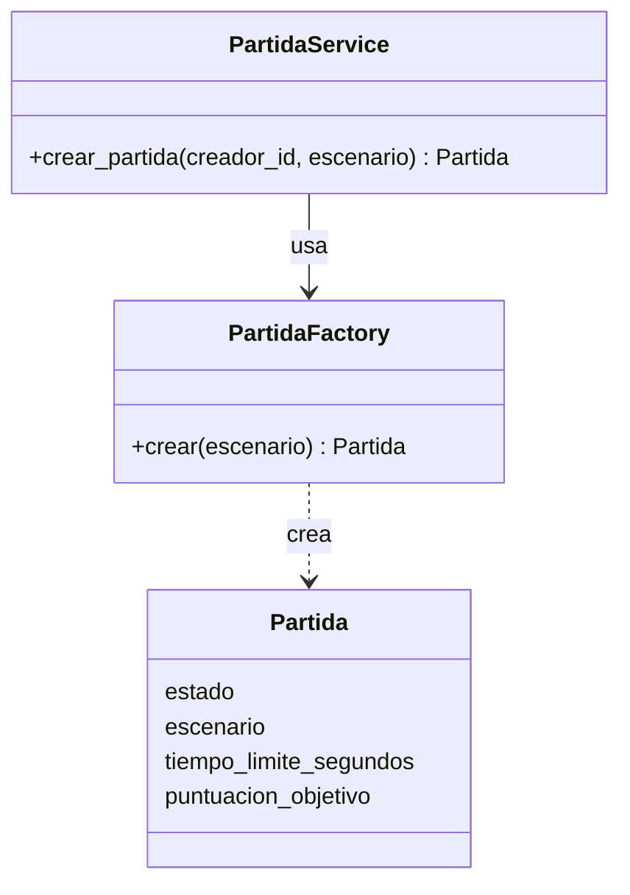
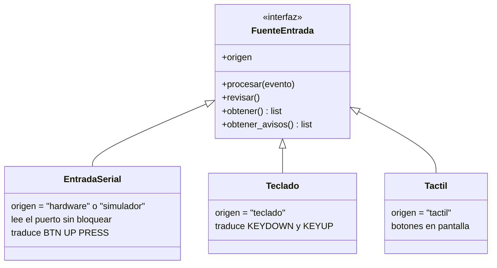
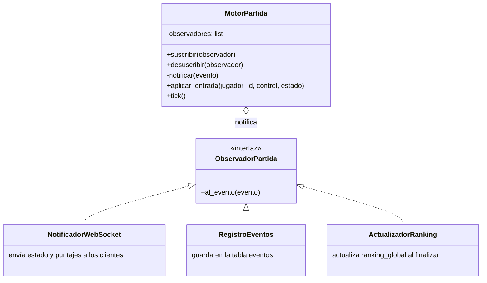

# ADR 0003: Patrones de arquitectura y de diseño

- **Estado:** Aceptado
- **Fecha:** 2026-10-11
- **Relacionado:** ADR 0001 (stack), ADR 0002 (cliente móvil), `docs/contrato-api-hardware.md`,
  `docs/arquitectura/`

## Contexto

El Sprint 2 pide seleccionar y justificar los patrones de arquitectura y de diseño del producto,
con al menos un patrón creacional, uno estructural y uno de comportamiento. Parte de ellos ya está
en el código de `develop`; este ADR los deja documentados y define el que falta.

## Resumen

| Patrón | Tipo | Dónde | Estado |
| --- | --- | --- | --- |
| Cliente-servidor con servidor autoritativo | Arquitectura | Cliente pygame ↔ backend FastAPI | REST implementado; tiempo real con US-08 y US-25 |
| Arquitectura en capas | Arquitectura | `server/app/`: `api` → `services` → `repositories` → `models` | Implementado |
| Repository | Acceso a datos | `UsuarioRepository`, `PartidaRepository` | Implementado |
| **Factory** | **Creacional** | `PartidaFactory` | Implementado (US-07) |
| **Adapter** | **Estructural** | `FuenteEntrada` y sus fuentes (serial, simulador, teclado, táctil) | Implementado para serial y simulador; teclado y táctil en el prototipo móvil |
| **Observer** | **Comportamiento** | Motor de partida → WebSocket, eventos y ranking | Aceptado; se implementa con US-25 |
| Strategy | Comportamiento | Movimiento de los guardianes | Propuesto para el Sprint 3 |
| State | Comportamiento | Estados del jugador (activo, escudado, aturdido, eliminado) | Propuesto para el Sprint 3 |

## Patrones de arquitectura

### Cliente-servidor con servidor autoritativo

El cliente (pygame en escritorio o pygbag en el navegador) solo dibuja y envía entradas. El
servidor decide el movimiento, las colisiones, los puntajes y el ganador.

- **Por qué:** con varios jugadores y varias fuentes de entrada (teclado, táctil, Arduino), una
  sola fuente de verdad evita trampas y estados distintos entre clientes.
- **Consecuencia:** el cliente necesita una conexión en tiempo real (WebSocket) para recibir el
  estado de la partida. La latencia medida en el prototipo móvil fue de 33 ms, lejos del límite de
  500 ms (ADR 0002).

### Arquitectura en capas (backend)

| Capa | Carpeta | Responsabilidad | Ejemplo |
| --- | --- | --- | --- |
| API | `api/routes/` | Validar la petición (Pydantic) y traducir errores a códigos HTTP | `auth.py`, `partidas.py` |
| Tiempo real | `realtime/` | Canal WebSocket de cada partida | Pendiente (US-08) |
| Servicios | `services/` | Reglas de negocio (RN-01, RN-04…) | `RegistroService`, `PartidaService` |
| Repositorios | `repositories/` | Consultas y escrituras en la base de datos | `PartidaRepository` |
| Modelos | `models/` | Tablas de SQLAlchemy | `Usuario`, `Partida`, `Evento` |

Cada capa solo llama a la de abajo. Un endpoint nunca hace consultas SQL y un servicio nunca
devuelve códigos HTTP.

- **Por qué:** cada integrante trabaja en una capa o historia sin pisar a los demás, y los
  servicios se prueban sin levantar el servidor.
- **Consecuencia:** hay más archivos por historia (ruta, servicio, repositorio), pero cada uno es
  corto y tiene una sola razón para cambiar.

### Repository

Los repositorios encapsulan el acceso a PostgreSQL con SQLAlchemy. Los servicios piden datos por
intención (`jugador_en_partida_activa`, `existe_correo`) y no saben cómo se consultan.

- **Por qué:** las reglas de negocio quedan separadas del SQL, y en las pruebas unitarias se
  puede pasar un repositorio falso.
- **Dónde:** `server/app/repositories/`.

## Patrones de diseño

### Factory (creacional): creación de partidas

**Problema.** Una partida nueva necesita un escenario válido (o uno al azar), el tiempo límite, la
puntuación objetivo y el estado inicial. Si cada servicio armara la partida, esas reglas quedarían
repetidas.

**Solución.** `PartidaFactory.crear()` es el único lugar que sabe construir una `Partida` válida.
`PartidaService` la recibe por el constructor, así que en las pruebas se le puede pasar otra
fábrica.



**Código:** `server/app/services/partida_factory.py` (US-07).

**En el Sprint 3** la misma idea se usa para crear guardianes, eventos especiales y
bonificaciones según el escenario, como sugiere el enunciado.

### Adapter (estructural): fuentes de entrada

**Problema.** El jugador puede moverse con el teclado, con botones táctiles en el celular, con el
control Arduino por USB o con el simulador. Cada una entrega los datos de forma distinta: eventos
de pygame, toques en la pantalla o líneas de texto por el puerto serial (`BTN UP PRESS`).

**Solución.** Todas implementan la interfaz `FuenteEntrada`, que entrega pares
`(control, estado)` con los valores del contrato (`arriba`, `presionado`…). El cliente arma el
mensaje WebSocket `entrada` sin saber de qué fuente viene.



**Código:** `client/src/entrada/base.py` y `client/src/entrada/serial_entrada.py`. `Teclado` y
`Tactil` están en `prototipos/cliente-movil/entrada.py` y se pasan a `client/src/entrada/`
junto con la pantalla de juego (US-25).

- **Por qué:** agregar un joystick o una placa con WiFi solo agrega un adaptador; el resto del
  cliente y el servidor no cambian (principio abierto/cerrado).
- **Comprobado:** el prototipo móvil movió jugadores con teclado, táctil y simulador al mismo
  tiempo (ADR 0002).

### Observer (comportamiento): actualizaciones de la partida en tiempo real

**Problema.** Cuando algo pasa en la partida (un jugador se mueve, gana puntos, queda aturdido o la
partida termina), varias partes tienen que enterarse: los clientes conectados por WebSocket, la
tabla de eventos y el ranking global. Si el motor de partida llamara a cada una directamente,
quedaría acoplado al WebSocket y a la base de datos, y cada función nueva (por ejemplo la ceremonia
del ganador) obligaría a modificarlo.

**Solución.** El motor de partida es el **sujeto**: guarda una lista de observadores y les avisa
cada evento. Cada observador decide qué hacer con él.



Eventos previstos: `estado_actualizado` (posiciones, en cada tick), `puntaje_cambiado`,
`jugador_aturdido`, `partida_finalizada`.

Esqueleto propuesto para `server/app/realtime/`:

```python
class ObservadorPartida(Protocol):
    async def al_evento(self, evento: EventoPartida) -> None: ...


class MotorPartida:
    def __init__(self, partida_id: int) -> None:
        self.partida_id = partida_id
        self._observadores: list[ObservadorPartida] = []

    def suscribir(self, observador: ObservadorPartida) -> None:
        self._observadores.append(observador)

    async def _notificar(self, evento: EventoPartida) -> None:
        for observador in self._observadores:
            try:
                await observador.al_evento(evento)
            except Exception:
                log.exception("Falló un observador de la partida %s", self.partida_id)
```

- **Por qué este patrón:** el enunciado lo sugiere para "actualizar puntajes y rankings en tiempo
  real", que es el centro del juego. Además, `Evento` y `RankingGlobal` ya están en el modelo de
  datos, así que cada uno tiene un observador natural.
- **Alcance del Sprint 2:** el motor con `NotificadorWebSocket` (posiciones de los jugadores,
  US-25). `RegistroEventos` y `ActualizadorRanking` se agregan en el Sprint 3 sin tocar el motor.
- **Reglas:** un observador que falla no detiene la partida (se registra en el log), y ningún
  observador hace trabajo bloqueante dentro del ciclo del motor.
- **Pruebas:** el motor se prueba con un observador falso que guarda los eventos recibidos, sin
  WebSocket ni base de datos.

### Propuestos para el Sprint 3

- **Strategy** para el movimiento de los guardianes (ruta fija, patrulla, persecución): cada
  comportamiento es una clase intercambiable.
- **State** para los estados del jugador (activo, escudado, aturdido, eliminado temporalmente):
  cada estado decide si acepta entradas y cómo recibe daño. Cubre CU-07, excepción E3.

Se deciden cuando se implementen los guardianes y los estados, con su propio ADR si cambia algo
de lo descrito aquí.

## Principios SOLID en el código actual

| Principio | Dónde se ve |
| --- | --- |
| Responsabilidad única | Rutas, servicios y repositorios separados; `protocolo_serial.py` solo interpreta líneas y `serial_entrada.py` solo lee el puerto |
| Abierto/cerrado | Nuevas fuentes de entrada (Adapter) y nuevos observadores sin modificar el código existente |
| Sustitución de Liskov | Cualquier `FuenteEntrada` sirve donde el cliente espera una fuente |
| Segregación de interfaces | `FuenteEntrada` trae métodos opcionales con implementación vacía; cada fuente redefine solo los que usa |
| Inversión de dependencias | `PartidaService` recibe el repositorio y la fábrica; el hash de contraseñas depende de la interfaz `PasswordHasher`; FastAPI inyecta la sesión con `Depends(get_session)` |

## Consecuencias

- Hay un patrón de cada tipo exigido: Factory (creacional), Adapter (estructural) y Observer (de
  comportamiento). Factory, Adapter y Repository ya están en `develop` con pruebas.
- El responsable de US-08 y US-25 implementa el motor de partida siguiendo el Observer descrito
  aquí.
- Los diagramas de componentes, la vista lógica y la de despliegue están en `docs/arquitectura/`
  y reemplazan las vistas del ERS del Sprint 1.
