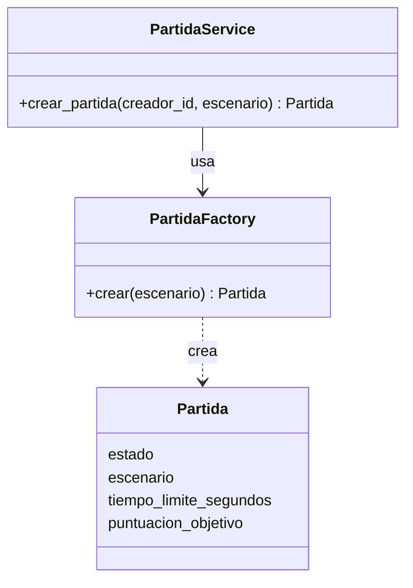
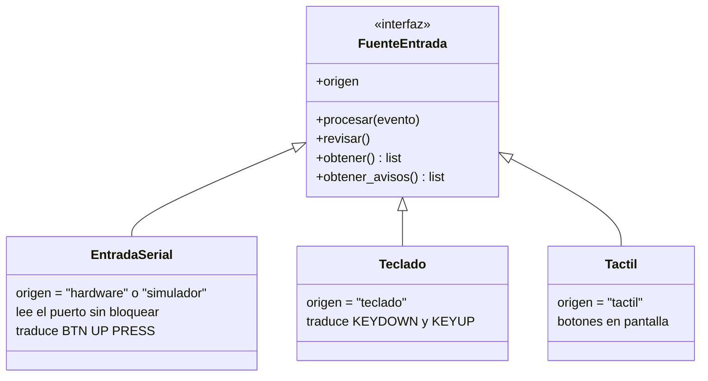
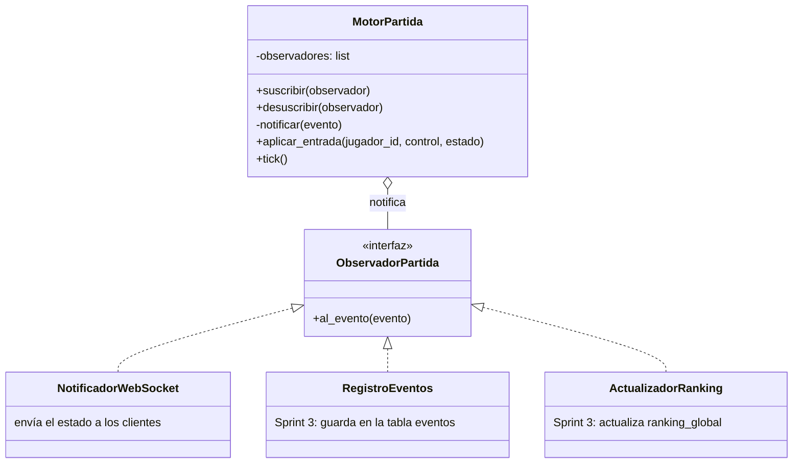

# ADR 0003: Patrones de arquitectura y de diseño

- **Estado:** Aceptado
- **Fecha:** 2026-10-11 (actualizado el 2026-10-18 con los drivers y el canal en tiempo real, y el
  2026-10-20 con el motor de partida y las entradas del jugador)
- **Relacionado:** ADR 0001 (stack), ADR 0002 (cliente móvil), `docs/contrato-api-hardware.md`,
  `docs/arquitectura/`

## Contexto

El Sprint 2 pide seleccionar y justificar los patrones de arquitectura y de diseño del producto,
con al menos un patrón creacional, uno estructural y uno de comportamiento. Parte de ellos ya está
en el código de `develop`; este ADR los deja documentados y define el que falta. Los nombres de
los patrones de arquitectura siguen los del curso (Tema 4: cliente-servidor, capas, publicar-suscribir,
monolito frente a microservicios).

## Drivers arquitectónicos

Los requisitos que más pesan en la arquitectura y la decisión que responde a cada uno:

| Driver | Origen | Decisión |
| --- | --- | --- |
| Movimientos reflejados en menos de 500 ms | RNF-02 | Canal WebSocket por partida y servidor autoritativo; medido: 33 ms en el celular (ADR 0002) |
| Al menos dos jugadores simultáneos | RNF-01 | Publicar-suscribir: cada mensaje del servidor llega a todos los jugadores de la partida |
| Computadora y celular | RNF-07 | Un solo cliente pygame, compilado con pygbag para el navegador (ADR 0002) |
| Control físico de 5 botones | RNF-10 | Arduino por USB Serial a la PC del jugador; Adapter para que el resto del cliente no note la diferencia |
| Agregar funcionalidades sin rehacer lo existente | RNF-06 | Capas, Repository, Factory y Observer: lo nuevo se agrega como clase nueva |
| Contenedores, base de datos y nube | RNF-05, RNF-09, RNF-11 | Backend y PostgreSQL en Docker Compose; la misma imagen sirve para la nube |
| Equipo de tres personas, sprints de un mes | Restricción del proyecto | Un solo backend (monolito modular) en vez de microservicios |

## Resumen

| Patrón | Tipo | Dónde | Estado |
| --- | --- | --- | --- |
| Cliente-servidor de 3 niveles, cliente delgado | Arquitectura | Cliente pygame ↔ backend FastAPI ↔ PostgreSQL | REST, canal WebSocket y movimiento en el servidor implementados; arena del cliente con US-25 |
| Arquitectura en capas (monolito modular) | Arquitectura | `server/app/`: `api` → `services` → `repositories` → `models` | Implementado |
| Publicar-suscribir | Arquitectura | Canal WebSocket de cada partida (`ConnectionManager`) | Implementado (US-08) |
| Repository | Acceso a datos | `UsuarioRepository`, `PartidaRepository` | Implementado |
| **Factory** | **Creacional** | `PartidaFactory` | Implementado (US-07) |
| **Adapter** | **Estructural** | `FuenteEntrada` y sus fuentes (serial, simulador, teclado, táctil) | Implementado: serial, simulador, teclado y táctil (AB#40) |
| **Observer** | **Comportamiento** | Motor de partida → WebSocket, eventos y ranking | Implementado: `MotorPartida` y `NotificadorWebSocket` (US-25) |
| Strategy | Comportamiento | Movimiento de los guardianes | Propuesto para el Sprint 3 |
| State | Comportamiento | Estados del jugador (activo, escudado, aturdido, eliminado) | Propuesto para el Sprint 3 |

## Patrones de arquitectura

### Cliente-servidor de 3 niveles con cliente delgado

| Nivel | Qué corre | Dónde |
| --- | --- | --- |
| Presentación | Cliente pygame: pantallas, entradas y dibujo de la arena | PC del jugador o navegador del celular |
| Lógica | Backend FastAPI: reglas, partidas y canal en tiempo real | Contenedor `server` |
| Datos | PostgreSQL | Contenedor `db` |

El cliente es **delgado**: solo dibuja y envía entradas. El servidor es **autoritativo**: decide el
movimiento, las colisiones, los puntajes y el ganador.

- **Por qué:** con varios jugadores y varias fuentes de entrada (teclado, táctil, Arduino), una
  sola fuente de verdad evita trampas y estados distintos entre clientes.
- **Consecuencia:** el cliente necesita una conexión en tiempo real (WebSocket) para recibir el
  estado de la partida. La latencia medida en el prototipo móvil fue de 33 ms, lejos del límite de
  500 ms (ADR 0002).

### Arquitectura en capas (backend)

| Capa | Carpeta | Responsabilidad | Ejemplo |
| --- | --- | --- | --- |
| API | `api/routes/` | Validar la petición (Pydantic) y traducir errores a códigos HTTP | `auth.py`, `partidas.py` |
| Tiempo real | `realtime/`, `api/routes/canal_partida.py` | Canal WebSocket de cada partida | `ConnectionManager` (US-08) |
| Servicios | `services/` | Reglas de negocio (RN-01, RN-04…) | `RegistroService`, `PartidaService` |
| Repositorios | `repositories/` | Consultas y escrituras en la base de datos | `PartidaRepository` |
| Modelos | `models/` | Tablas de SQLAlchemy | `Usuario`, `Partida`, `Evento` |

Cada capa solo llama a la de abajo. Un endpoint nunca hace consultas SQL y un servicio nunca
devuelve códigos HTTP.

- **Por qué:** cada integrante trabaja en una capa o historia sin pisar a los demás, y los
  servicios se prueban sin levantar el servidor.
- **Consecuencia:** hay más archivos por historia (ruta, servicio, repositorio), pero cada uno es
  corto y tiene una sola razón para cambiar.
- **Monolito modular en vez de microservicios:** el ERS del Sprint 1 proponía microservicios
  (autenticación, servidor de juego, ranking y gateway de hardware) detrás de un balanceador. Para
  un equipo de tres personas eso multiplica despliegues, configuraciones y pruebas de integración
  sin una necesidad real de escalar por separado. Se elige un solo backend en capas; si más adelante
  hace falta, los módulos `auth`, `partidas` y `realtime` ya están separados.

### Publicar-suscribir en el canal de cada partida

Cada partida tiene un canal (`/ws/partidas/{id}`). Los jugadores se **suscriben** al conectarse y
el servidor **publica** en el canal con `ConnectionManager.difundir()`: todos los suscriptores
reciben el mensaje (`jugador_conectado`, `jugador_desconectado` y, con US-25, el estado de la
partida).

- **Por qué:** cumple RNF-01 y RNF-02 con una sola conexión abierta por jugador, sin que el cliente
  tenga que preguntar cada cierto tiempo.
- **Desacoplamiento:** quien publica no conoce a los suscriptores; una conexión caída se descarta
  sin afectar a los demás.
- **Límite conocido:** los canales viven en la memoria de un solo proceso del backend. Con varias
  instancias detrás de un balanceador haría falta un intermediario (patrón Broker, por ejemplo Redis
  publicar-suscribir). Para el alcance del curso basta una instancia.
- **Provisional:** mientras no exista el inicio de sesión (US-03), el canal identifica al jugador con
  `jugador_id` en la URL y solo verifica que participe en la partida. Se reemplaza por el token JWT
  que define el contrato de hardware (`?token=`).
- **Código:** `server/app/realtime/connection_manager.py`, `server/app/api/routes/canal_partida.py`;
  en el cliente, `client/src/realtime_client.py` sobre la interfaz `Conexion` de `client/src/red/`,
  con una implementación para escritorio y otra para el navegador (ADR 0002).

### Patrones de arquitectura vistos en el curso que no se usan

| Patrón | Por qué no |
| --- | --- |
| Microservicios | Ver arriba: más costo de operación que beneficio para tres personas |
| Orientado a eventos con bus de eventos (EDA) | El juego necesita respuestas inmediatas dentro de una partida; basta publicar-suscribir en memoria, sin un bus aparte |
| Broker | Solo hay un servidor; se volvería necesario con varias instancias (ver el límite de arriba) |
| Modelo-Vista-Controlador | El cliente es delgado y no tiene un modelo propio que sincronizar; el estado vive en el servidor |
| Maestro-esclavo | No hay trabajo que repartir entre nodos de cómputo |
| Tubería y filtros | No hay un flujo de datos por etapas; la única cadena (Serial → línea → entrada) es pequeña y queda dentro del Adapter |
| Peer-to-peer | Sin servidor autoritativo cada jugador podría alterar su propio estado |
| SOA | No hay otros sistemas de la organización con los que integrarse |

### Repository

Los repositorios encapsulan el acceso a PostgreSQL con SQLAlchemy. Los servicios piden datos por
intención (`jugador_en_partida_activa`, `existe_correo`) y no saben cómo se consultan.

- **Por qué:** las reglas de negocio quedan separadas del SQL, y en las pruebas unitarias se
  puede pasar un repositorio falso.
- **Dónde:** `server/app/repositories/`.

## Patrones de diseño

### Factory (creacional): creación de partidas

**Problema.** Una partida nueva necesita un escenario válido (o uno al azar), el tiempo límite, la
puntuación objetivo y el estado inicial. Si cada servicio armara la partida, esas reglas quedarían
repetidas.

**Solución.** `PartidaFactory.crear()` es el único lugar que sabe construir una `Partida` válida.
`PartidaService` la recibe por el constructor, así que en las pruebas se le puede pasar otra
fábrica.



**Código:** `server/app/services/partida_factory.py` (US-07).

**En el Sprint 3** la misma idea se usa para crear guardianes, eventos especiales y
bonificaciones según el escenario, como sugiere el enunciado.

### Adapter (estructural): fuentes de entrada

**Problema.** El jugador puede moverse con el teclado, con botones táctiles en el celular, con el
control Arduino por USB o con el simulador. Cada una entrega los datos de forma distinta: eventos
de pygame, toques en la pantalla o líneas de texto por el puerto serial (`BTN UP PRESS`).

**Solución.** Todas implementan la interfaz `FuenteEntrada`, que entrega pares
`(control, estado)` con los valores del contrato (`arriba`, `presionado`…). El cliente arma el
mensaje WebSocket `entrada` sin saber de qué fuente viene.



**Código:** `client/src/entrada/` (`base.py`, `serial_entrada.py`, `teclado.py`, `tactil.py`).
`ControlesJugador` (`controles.py`) junta las fuentes y envía cada cambio al canal de la partida con
el mensaje `entrada` del contrato; `crear_fuentes()` elige las fuentes según la plataforma: táctil
en el navegador y Arduino o simulador en escritorio si se configura `CONTROL_PUERTO`.

- **Por qué:** agregar un joystick o una placa con WiFi solo agrega un adaptador; el resto del
  cliente y el servidor no cambian (principio abierto/cerrado).
- **Comprobado:** el prototipo móvil movió jugadores con teclado, táctil y simulador al mismo
  tiempo (ADR 0002). En el cliente real, 1 s de tecla o de botón del simulador movió al jugador
  120 px en el servidor, igual a la velocidad del motor; el servidor recibe el mismo mensaje
  salvo el campo `origen`.

### Observer (comportamiento): actualizaciones de la partida en tiempo real

**Problema.** Cuando algo pasa en la partida (un jugador se mueve, gana puntos, queda aturdido o la
partida termina), varias partes tienen que enterarse: los clientes conectados por WebSocket, la
tabla de eventos y el ranking global. Si el motor de partida llamara a cada una directamente,
quedaría acoplado al WebSocket y a la base de datos, y cada función nueva (por ejemplo la ceremonia
del ganador) obligaría a modificarlo.

**Solución.** El motor de partida es el **sujeto**: guarda una lista de observadores y les avisa
cada evento. Cada observador decide qué hacer con él.



Eventos: `estado_actualizado` (posiciones, implementado). Previstos para el Sprint 3:
`puntaje_cambiado`, `jugador_aturdido` y `partida_finalizada`.

**Código (US-25):** `server/app/realtime/motor_partida.py` (sujeto, un tick cada 50 ms),
`notificador_websocket.py` (observador que publica con `ConnectionManager.difundir()`),
`eventos.py` y `gestor_motores.py`, que crea un motor por partida y le suscribe el notificador
(es quien arma el objeto, así el motor no conoce el WebSocket). Núcleo del sujeto:

```python
class ObservadorPartida(Protocol):
    async def al_evento(self, evento: EventoPartida) -> None: ...


class MotorPartida:
    def suscribir(self, observador: ObservadorPartida) -> None:
        self._observadores.append(observador)

    async def _notificar(self, evento: EventoPartida) -> None:
        for observador in list(self._observadores):
            try:
                await observador.al_evento(evento)
            except Exception:  # un observador que falla no detiene la partida
                log.exception("Falló un observador de la partida %s", self.partida_id)
```

- **Por qué este patrón:** el enunciado lo sugiere para "actualizar puntajes y rankings en tiempo
  real", que es el centro del juego. Además, `Evento` y `RankingGlobal` ya están en el modelo de
  datos, así que cada uno tiene un observador natural.
- **Alcance del Sprint 2:** el motor con `NotificadorWebSocket` (posiciones de los jugadores,
  US-25). `RegistroEventos` y `ActualizadorRanking` se agregan en el Sprint 3 suscribiéndolos en
  `GestorMotores`, sin tocar el motor.
- **Reglas:** un observador que falla no detiene la partida (se registra en el log), y ningún
  observador hace trabajo bloqueante dentro del ciclo del motor.
- **Pruebas:** el motor se prueba con un observador falso que guarda los eventos recibidos, sin
  WebSocket ni base de datos (task de pruebas de movimiento de US-25).

### Propuestos para el Sprint 3

- **Strategy** para el movimiento de los guardianes (ruta fija, patrulla, persecución): cada
  comportamiento es una clase intercambiable.
- **State** para los estados del jugador (activo, escudado, aturdido, eliminado temporalmente):
  cada estado decide si acepta entradas y cómo recibe daño. Cubre CU-07, excepción E3.

Se deciden cuando se implementen los guardianes y los estados, con su propio ADR si cambia algo
de lo descrito aquí.

## Principios SOLID en el código actual

| Principio | Dónde se ve |
| --- | --- |
| Responsabilidad única | Rutas, servicios y repositorios separados; `protocolo_serial.py` solo interpreta líneas y `serial_entrada.py` solo lee el puerto |
| Abierto/cerrado | Nuevas fuentes de entrada (Adapter) y nuevos observadores sin modificar el código existente |
| Sustitución de Liskov | Cualquier `FuenteEntrada` sirve donde el cliente espera una fuente |
| Segregación de interfaces | `FuenteEntrada` trae métodos opcionales con implementación vacía; cada fuente redefine solo los que usa |
| Inversión de dependencias | `PartidaService` recibe el repositorio y la fábrica; el hash de contraseñas depende de la interfaz `PasswordHasher`; FastAPI inyecta la sesión con `Depends(get_session)` |

## Consecuencias

- Los patrones de arquitectura (cliente-servidor de 3 niveles, capas y publicar-suscribir) responden a
  los drivers de la tabla del inicio.
- Hay un patrón de cada tipo exigido: Factory (creacional), Adapter (estructural) y Observer (de
  comportamiento). Los cuatro (con Repository) ya están en `develop`.
- El motor de partida de US-25 sigue el Observer descrito aquí; los observadores del Sprint 3 se
  agregan sin modificarlo.
- Los diagramas de componentes, la vista lógica y la de despliegue están en `docs/arquitectura/`
  y reemplazan las vistas del ERS del Sprint 1.
