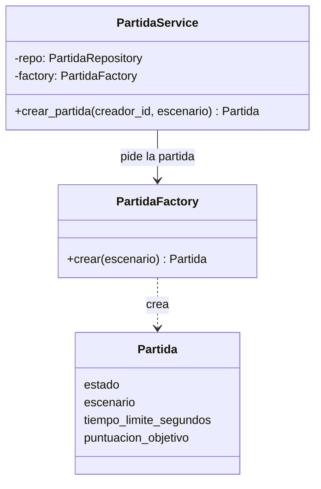

# ADR 0004: Factory para crear partidas

- **Categoría:** patrón creacional
- **Estado:** Implementado (US-07, Sprint 2)
- **Fecha:** 2026-10-25
- **Relacionado:** ADR 0003 (arquitectura), ADR 0009 (Repository)

## Contexto

Una partida nueva tiene que nacer válida: estado `esperando`, un escenario del catálogo (o uno al
azar si el jugador no elige), el tiempo límite de 300 s y la puntuación objetivo de 500 puntos
(ERS, US-07). La partida se crea desde el endpoint `POST /partidas`, y en el Sprint 3 también se
crearán desde eventos del juego (revancha, partida rápida).

Si cada lugar que necesita una partida armara el objeto `Partida` con sus valores, esas reglas
quedarían repetidas y un cambio (por ejemplo, otro escenario o otro tiempo límite) obligaría a
buscar todos los lugares (va contra DRY).

## Decisión

Usar el patrón **Factory**: un único objeto fábrica que sabe construir una `Partida` válida. Quien
necesita una partida la pide a la fábrica sin saber cómo se arma.

| Rol del patrón | Clase en el proyecto | Archivo |
| --- | --- | --- |
| Cliente | `PartidaService` | `server/app/services/partida_service.py` |
| Fábrica | `PartidaFactory.crear(escenario=None)` | `server/app/services/partida_factory.py` |
| Producto | `Partida` (modelo SQLAlchemy) | `server/app/models/partida.py` |



```python
class PartidaFactory:
    def crear(self, escenario: str | None = None) -> Partida:
        if escenario is not None and escenario not in ESCENARIOS:
            raise ValueError(f"Escenario no válido: {escenario}")
        return Partida(
            estado=EstadoPartida.esperando,
            escenario=escenario or random.choice(ESCENARIOS),
            tiempo_limite_segundos=TIEMPO_LIMITE_SEGUNDOS,
            puntuacion_objetivo=PUNTUACION_OBJETIVO,
        )
```

`PartidaService` recibe la fábrica por el constructor (`PartidaService(repo, factory=None)`), así
que en las pruebas se le puede pasar otra.

**La misma idea en el cliente.** Dos funciones fábrica devuelven distintas clases concretas sin que
quien las usa las conozca:

- `crear_fuentes(ancho, alto, puerto_control, en_navegador)` (`client/src/entrada/controles.py`)
  devuelve `Teclado`, `Tactil` o `EntradaSerial` según la plataforma (ADR 0005).
- `crear_conexion(url)` (`client/src/red/websocket.py`) devuelve `ConexionEscritorio` o
  `ConexionNavegador` (ADR 0008).

**Aclaración.** `PartidaFactory` es una fábrica simple: hay un solo producto (`Partida`) y no hay
subclases de la fábrica. No es un Factory Method con jerarquía de creadores. Ese paso se da en el
Sprint 3, cuando haya varios tipos de producto (ver abajo).

## Alternativas consideradas

| Alternativa | Por qué no |
| --- | --- |
| Construir `Partida(...)` directamente en el servicio o en el endpoint | Las reglas de una partida válida quedan repartidas; cada nuevo lugar que crea partidas las repite |
| Valores por defecto en el modelo SQLAlchemy | El escenario al azar y la validación contra el catálogo no son responsabilidad del modelo; además, las pruebas tendrían que pasar por la base de datos |
| Builder | La partida tiene cuatro valores y ningún paso opcional; un Builder agrega clases sin resolver nada. Se reconsidera si la configuración de la partida crece (arena, obstáculos, guardianes, duración) |
| Abstract Factory | Solo tiene sentido con familias de objetos relacionados; hoy hay un solo producto |
| Singleton para la fábrica | No hace falta una sola instancia y dificulta las pruebas; FastAPI ya inyecta dependencias |

## Consecuencias

**Positivas**

- Un solo lugar con las reglas de una partida nueva (DRY, responsabilidad única).
- `PartidaService` no depende de cómo se arma la partida, y se prueba con otra fábrica
  (inversión de dependencias).
- Agregar un escenario solo toca `ESCENARIOS`.
- La fábrica se prueba sin base de datos: `server/tests/test_partidas.py` (`test_factory_*`).

**Negativas**

- Una clase más para algo que hoy son cuatro líneas.
- Si se agregan muchos tipos de partida con `if` dentro de `crear()`, la fábrica crece y habría que
  pasar a un Factory Method o a un registro de fábricas.

## Sprint 3

El enunciado sugiere Factory para crear **guardianes, eventos especiales y bonificaciones**. Ahí sí
hay varios productos con una interfaz común (por ejemplo, `Guardian` con distintos tipos según el
escenario), y la fábrica pasa a elegir la clase concreta.
