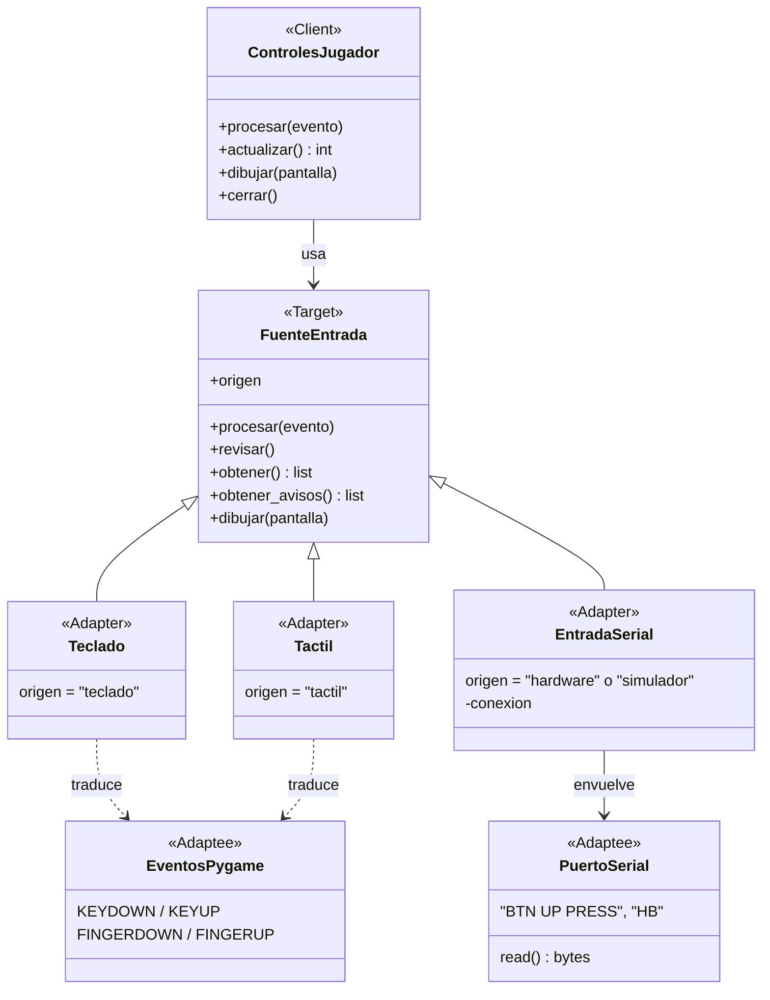

# ADR 0005: Adapter para las fuentes de entrada del jugador

- **Categoría:** patrón estructural (el principal del proyecto)
- **Estado:** Implementado (AB#40, US-25, Sprint 2)
- **Fecha:** 2026-10-25
- **Relacionado:** ADR 0002 (cliente móvil), `docs/contrato-api-hardware.md`, ADR 0004 (Factory)

## Contexto

El jugador se mueve con cuatro fuentes distintas, y cada una entrega los datos a su manera:

| Fuente | Qué entrega | Dónde |
| --- | --- | --- |
| Teclado | Eventos `KEYDOWN` y `KEYUP` de pygame (flechas, WASD, espacio) | PC |
| Botones táctiles | Eventos de dedo y de mouse sobre una cruceta dibujada | Navegador del celular (pygbag) |
| Control Arduino | Líneas de texto por USB Serial: `HELLO CR-PAD-01 1.0`, `BTN UP PRESS`, `HB` | PC con el control conectado |
| Simulador del control | Las mismas líneas por un socket local (`socket://localhost:7777`) | PC sin hardware |

El servidor espera siempre el mismo mensaje WebSocket del contrato de hardware:

```json
{"tipo": "entrada", "control": "arriba", "estado": "presionado", "origen": "teclado", "seq": 12}
```

Ninguna de las cuatro fuentes entrega eso: sus interfaces son incompatibles con lo que necesita el
cliente. Además, el control físico tiene reglas propias (latidos, desconexión a los 3 s y reintento
cada 2 s) que no deberían mezclarse con la pantalla de juego.

## Decisión

Usar el patrón **Adapter**. Se define una interfaz común, `FuenteEntrada`, que entrega pares
`(control, estado)` con los valores del contrato, y un adaptador por cada tipo de fuente que
traduce lo suyo a esa interfaz. `ControlesJugador` (el cliente del patrón) junta las fuentes y arma
el mensaje `entrada` sin saber de dónde viene cada cambio.

| Rol del patrón | Clase en el proyecto | Archivo |
| --- | --- | --- |
| **Client** | `ControlesJugador`: llama `procesar(evento)`, `revisar()` y `obtener()` y envía el mensaje `entrada` | `client/src/entrada/controles.py` |
| **Target** (interfaz del cliente) | `FuenteEntrada`: `procesar()`, `revisar()`, `obtener() -> [(control, estado)]`, `obtener_avisos()`, `dibujar()` | `client/src/entrada/base.py` |
| **Adapter** | `Teclado` | `client/src/entrada/teclado.py` |
| **Adapter** | `Tactil` | `client/src/entrada/tactil.py` |
| **Adapter** | `EntradaSerial` (Arduino y simulador) | `client/src/entrada/serial_entrada.py` |
| **Adaptee** | Eventos de pygame (teclas) | pygame |
| **Adaptee** | Eventos de dedo y mouse del navegador | pygame / pygbag |
| **Adaptee** | Puerto serial o socket de pyserial (`serial_for_url`) con las líneas del contrato | pyserial; las líneas se interpretan con `interpretar_linea()` de `protocolo_serial.py` |



Así se ve la traducción dentro de dos adaptadores:

```python
# Teclado: evento de pygame -> (control, estado)
TECLAS = {pygame.K_UP: "arriba", pygame.K_w: "arriba", ..., pygame.K_SPACE: "accion"}

# EntradaSerial: "BTN UP PRESS" -> ("arriba", "presionado")
mensaje = interpretar_linea(texto)
if isinstance(mensaje, Boton) and mensaje.estado == "presionado":
    self._pendientes.append((mensaje.control, "presionado"))
```

`EntradaSerial` recibe por parámetro la función que abre el puerto (`abrir=abrir_con_pyserial`),
igual que el esquema recomendado en clase donde el adaptador recibe el adaptee: en las pruebas se
le pasa un puerto falso y se prueba sin Arduino.

Las fuentes de cada plataforma las elige `crear_fuentes()` (Factory, ADR 0004): teclado siempre,
táctil solo en el navegador y control físico o simulador solo en escritorio si se configura
`CONTROL_PUERTO`.

## Alternativas consideradas

| Alternativa | Por qué no |
| --- | --- |
| Un `if origen == ...` en la pantalla de juego | Cada fuente nueva obliga a modificar la pantalla; la lógica del puerto serial (latidos, reintentos) quedaría mezclada con el dibujo de la arena |
| Que el servidor acepte cada formato (eventos de pygame, líneas `BTN ...`) | Saca al servidor de su papel: dependería del hardware y de pygame, y cada cliente mandaría cosas distintas |
| Un adaptador por fuente también para el simulador | El simulador manda exactamente las mismas líneas que el Arduino; pyserial abre los dos con `serial_for_url`, así que un solo adaptador sirve para ambos |
| Facade sobre las fuentes | Una fachada simplifica un subsistema con una interfaz nueva; aquí la interfaz (el mensaje `entrada`) ya existe y lo que hace falta es que cada fuente encaje en ella |

## Consecuencias

**Positivas**

- Agregar una fuente (por ejemplo, un control por WiFi o Bluetooth) es agregar un adaptador; el
  cliente y el servidor no cambian (abierto/cerrado).
- Cada adaptador se prueba aislado: `client/tests/test_entradas_jugador.py` (teclado, táctil y
  `ControlesJugador`), `test_entrada_serial.py` y `test_protocolo_serial.py`.
- `test_mismo_mensaje_desde_teclado_y_desde_el_control_fisico` comprueba que el servidor recibe el
  mismo mensaje sin importar la fuente (salvo `origen`).
- Cualquier `FuenteEntrada` sirve donde se espera una fuente (sustitución de Liskov).
- El joystick opcional (`USAR_JOYSTICK 1`) se resolvió en el firmware: manda las mismas líneas
  `BTN`, así que el cliente no cambió. El contrato de hardware es la interfaz que se mantiene fija.

**Negativas**

- Más clases (una interfaz y tres adaptadores) que un `if` por origen. Se justifica porque hay cuatro
  fuentes reales y cada una tiene comportamiento propio (repetición de teclas, varios dedos,
  latidos y reconexión).
- `FuenteEntrada` trae métodos opcionales con implementación vacía (`procesar`, `dibujar`); si la
  interfaz crece, conviene separarla (segregación de interfaces).

## Patrones relacionados

- **Facade** (ADR 0007) y **Bridge** (ADR 0008) también son estructurales y están en el cliente.
- **Adapter frente a Facade:** Adapter hace encajar cada fuente en una interfaz que ya existe;
  Facade crea una interfaz nueva y más simple sobre varias clases.
