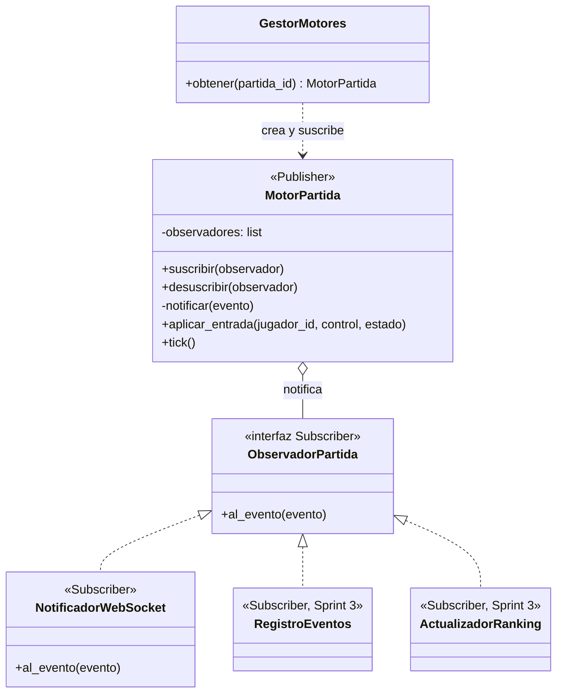

# ADR 0006: Observer para avisar lo que pasa en la partida

- **Categoría:** patrón de comportamiento
- **Estado:** Implementado (US-25, Sprint 2); observadores de puntaje y ranking planificados para
  el Sprint 3
- **Fecha:** 2026-10-25
- **Relacionado:** ADR 0003 (publicar-suscribir en el canal de la partida), ADR 0005 (Adapter)

## Contexto

El servidor es autoritativo: cada 50 ms el motor de la partida aplica las entradas, mueve a los
jugadores y decide qué cambió (RNF-02, menos de 500 ms). Cuando algo cambia, varias partes tienen
que enterarse:

- los clientes conectados por WebSocket, para dibujar la arena (Sprint 2);
- la tabla `eventos`, para el historial de la partida (Sprint 3);
- el ranking global, cuando cambian los puntajes o termina la partida (Sprint 3);
- la ceremonia del ganador (Sprint 3).

El motor no sabe cuántos interesados hay, y cada sprint agrega uno nuevo. Si el motor llamara a
cada uno directamente, quedaría acoplado al WebSocket y a la base de datos, y habría que
modificarlo cada vez. El enunciado sugiere Observer justamente para "actualizar puntajes y rankings
en tiempo real".

## Decisión

Usar el patrón **Observer**. El motor de cada partida es el **Publisher**: guarda una lista de
**Subscribers** y les avisa cada evento. Cada subscriber decide qué hacer con él.

| Rol del patrón | Clase en el proyecto | Archivo |
| --- | --- | --- |
| **Publisher** (sujeto) | `MotorPartida`: `suscribir()`, `desuscribir()`, `_notificar(evento)` y la lista `_observadores` | `server/app/realtime/motor_partida.py` |
| **Interfaz de los Subscribers** | `ObservadorPartida` (`Protocol` con `al_evento(evento)`) | `server/app/realtime/motor_partida.py` |
| **Subscriber concreto** | `NotificadorWebSocket`: envía el estado a todos los jugadores con `ConnectionManager.difundir()` | `server/app/realtime/notificador_websocket.py` |
| Evento | `EventoPartida(tipo, partida_id, datos)`; hoy `estado_actualizado` | `server/app/realtime/eventos.py` |
| Quien suscribe | `GestorMotores.obtener()`: crea un motor por partida y le suscribe el notificador | `server/app/realtime/gestor_motores.py` |



```python
class ObservadorPartida(Protocol):
    async def al_evento(self, evento: EventoPartida) -> None: ...


class MotorPartida:
    def suscribir(self, observador: ObservadorPartida) -> None:
        self._observadores.append(observador)

    def desuscribir(self, observador: ObservadorPartida) -> None:
        self._observadores.remove(observador)

    async def _notificar(self, evento: EventoPartida) -> None:
        for observador in list(self._observadores):
            try:
                await observador.al_evento(evento)
            except Exception:  # un observador que falla no detiene la partida
                log.exception("Falló un observador de la partida %s", self.partida_id)
```

**Flujo de una entrada:** el cliente manda `entrada` → `canal_partida.py` llama
`motor.aplicar_entrada()` → en el siguiente `tick()` el motor mueve al jugador y, si algo cambió,
notifica `estado_actualizado` → `NotificadorWebSocket` lo envía a todos los jugadores de la partida.

**Publicar-suscribir en el canal.** Además, `ConnectionManager.difundir()` envía `jugador_conectado`
y `jugador_desconectado` a todos los conectados de la partida (lobby). Eso es el estilo de
arquitectura publicar-suscribir (ADR 0003); el Observer de este ADR es el patrón de diseño dentro
del servidor.

**Reglas:**

- Un subscriber que falla no detiene la partida ni a los demás subscribers (se registra en el log).
- Ningún subscriber hace trabajo bloqueante dentro del ciclo del motor.
- El motor solo avisa si algo cambió, para no mandar mensajes repetidos cada 50 ms.

## Alternativas consideradas

| Alternativa | Por qué no |
| --- | --- |
| Que el motor llame a `ConnectionManager.difundir()` directamente | El motor queda acoplado al WebSocket; no se puede probar sin conexiones y cada interesado nuevo obliga a modificarlo |
| Que los clientes pregunten el estado cada cierto tiempo (polling por REST) | No cumple RNF-02 con varios jugadores y carga al servidor con peticiones vacías |
| Mediator | Coordina en los dos sentidos a objetos que se hablan entre sí. Aquí la comunicación va en un solo sentido (del motor a los interesados) y los interesados no se conocen. El servidor de partida sí actúa como mediador entre jugadores, pero eso es arquitectura (servidor autoritativo), no esta decisión |
| Bus de eventos externo (Redis, MQTT) | Más infraestructura sin necesidad: hay un solo proceso del backend (ver el límite en ADR 0003) |

## Consecuencias

**Positivas**

- El motor no conoce el WebSocket ni la base de datos: los subscribers del Sprint 3
  (`RegistroEventos`, `ActualizadorRanking`) se agregan suscribiéndolos en `GestorMotores`, sin
  modificar el motor (abierto/cerrado).
- El motor se prueba con un subscriber falso que guarda los eventos, sin red ni base de datos:
  `server/tests/test_motor_partida.py` (`test_avisa_el_estado_cuando_algo_cambia`,
  `test_no_avisa_si_nada_cambio`, `test_un_observador_que_falla_no_detiene_a_los_demas`,
  `test_desuscribir_deja_de_avisar`).
- La prueba de punta a punta del movimiento por WebSocket está en `test_movimiento_ws.py`.

**Negativas**

- El orden en que se avisa a los subscribers es el orden en que se suscribieron; si un subscriber
  dependiera de otro, habría que fijarlo explícitamente.
- Un subscriber lento retrasa el tick (se avisan uno por uno con `await`); por eso la regla de no
  hacer trabajo bloqueante. Si el ranking o los eventos tardan, se mandan a una tarea aparte.
- Los motores viven en la memoria de un proceso; con varias instancias del backend haría falta un
  intermediario (ADR 0003).

## Sprint 3: Strategy y State

Se planifican dos patrones de comportamiento más, sugeridos por el enunciado. No se implementan en
el Sprint 2:

- **Strategy** para el movimiento de los guardianes. El **contexto** es `Guardian`, que guarda una
  referencia a su estrategia y le delega `mover()`. Las **estrategias** son `RutaFija`, `Patrulla` y
  `Perseguir`, con una interfaz común de un solo método. El escenario o un evento especial (por
  ejemplo, la aparición de guardianes) elige la estrategia, no el guardián. Evita un
  `if tipo == "ruta" ... elif "patrulla" ...` que crece con cada comportamiento.
- **State** para los estados del jugador: Normal-Activo, Escudado, Aturdido y Eliminado
  temporalmente. El **contexto** es el jugador en la arena (`JugadorEnArena`), que guarda su
  estado actual y le delega qué hacer con una entrada o con un golpe; cada estado decide su
  transición (por ejemplo, Aturdido vuelve a Normal al acabarse el tiempo). Cubre CU-07,
  excepción E3.
- **Diferencia entre los dos:** en Strategy el cliente elige el algoritmo y las estrategias no se
  conocen entre sí; en State el objeto cambia solo y cada estado decide a cuál pasa.
