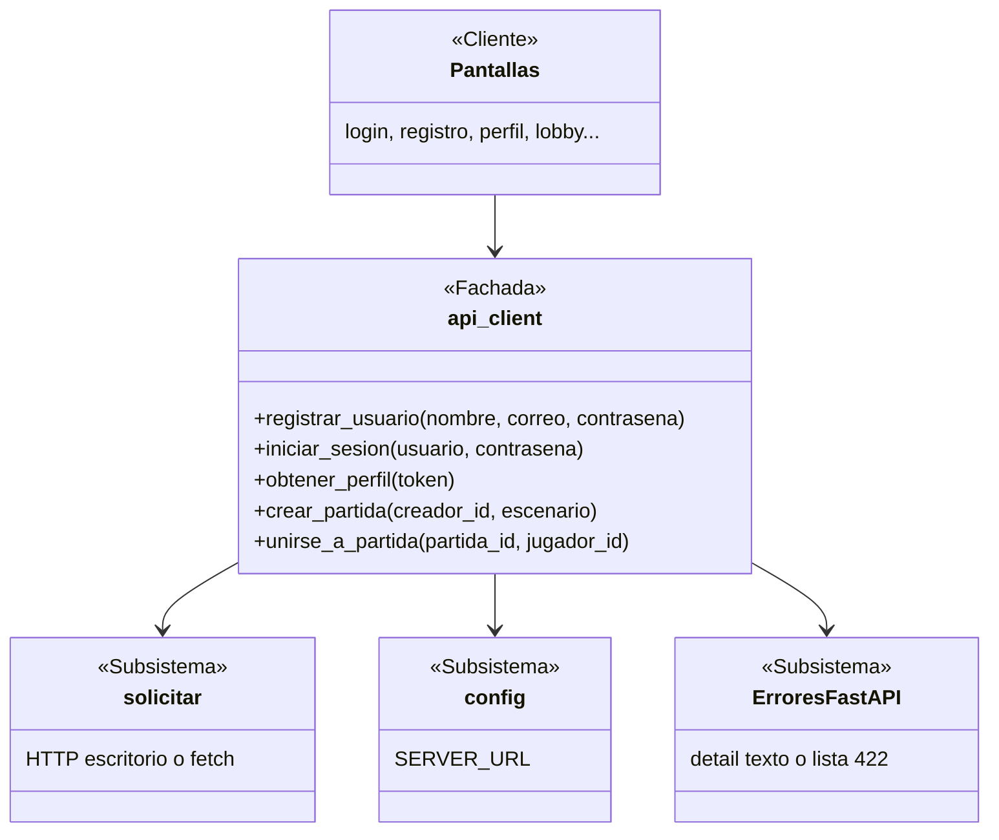

# ADR 0007: Facade para las llamadas del cliente al backend

- **Categoría:** patrón estructural (secundario)
- **Estado:** Implementado (US-01 a US-08, Sprint 2)
- **Fecha:** 2026-10-25
- **Relacionado:** ADR 0002 (cliente móvil), ADR 0008 (Bridge)

## Contexto

Para hablar con el backend, una pantalla del cliente tendría que saber varias cosas: la URL del
servidor (`SERVER_URL`), la ruta y el método de cada endpoint, cómo poner el token
(`Authorization: Bearer ...`), cómo enviar la petición en escritorio (`requests` en otro hilo) o en
el navegador (`fetch` de JavaScript), y cómo leer los errores de FastAPI (un texto en `detail`, o
una lista en los 422). Hay siete pantallas que llaman al backend (login, registro, verificación de
correo, recuperación, perfil, lobby y búsqueda de partidas). Si cada una hiciera todo eso, estarían
acopladas a los detalles de la red y repetirían el mismo código.

## Decisión

Usar el patrón **Facade**: el módulo `api_client` da una función simple por cada operación del
juego y esconde el resto.

| Rol del patrón | Elemento del proyecto | Archivo |
| --- | --- | --- |
| **Cliente** | Pantallas: `login.py`, `registro.py`, `verificar_correo.py`, `recuperar.py`, `perfil.py`, `lobby.py`, `buscar_partida.py` | `client/src/screens/` |
| **Fachada** | `api_client`: `registrar_usuario()`, `iniciar_sesion()`, `obtener_perfil()`, `crear_partida()`, `unirse_a_partida()`, `listar_partidas_disponibles()`… y una sola excepción, `ApiError` | `client/src/api_client.py` |
| **Subsistema** | `solicitar()`, `Respuesta` y `ErrorDeRed` (HTTP en escritorio y en navegador), `SERVER_URL`, cabeceras y lectura de errores de FastAPI | `client/src/red/http.py`, `client/src/config.py` |



Ejemplo: la pantalla de registro solo hace

```python
await registrar_usuario(nombre_usuario, correo, contrasena)
```

y si algo sale mal recibe `ApiError` con un mensaje listo para mostrar ("Sin conexión con el
servidor" o el detalle que mandó el servidor).

## Alternativas consideradas

| Alternativa | Por qué no |
| --- | --- |
| Que cada pantalla llame a `solicitar()` directamente | Repite la URL, las cabeceras y la lectura de errores en siete pantallas; un cambio de endpoint obliga a tocar varias |
| Una clase con estado (`ApiClient(token)`) | Hoy no hace falta guardar nada entre llamadas; el token vive en la sesión (`src/sesion.py`) y se pasa en cada llamada. Se reconsidera si la sesión crece |
| Adapter | No hay una interfaz ya definida a la que encajar; lo que hace falta es una interfaz nueva y más simple sobre varias piezas |

## Consecuencias

**Positivas**

- Las pantallas no saben si corren en escritorio o en el navegador ni cómo responde FastAPI
  (bajo acoplamiento).
- Un cambio en un endpoint se corrige en un solo lugar.
- Las pantallas se prueban reemplazando las funciones de la fachada, y la fachada se prueba
  reemplazando `solicitar()`: `client/tests/test_api_client.py`.

**Negativas**

- Riesgo de que `api_client` se convierta en un objeto todopoderoso (god object) a medida que se
  agregan endpoints. Si pasa, se parte por segregación de interfaces: una fachada de autenticación
  y perfil, y otra de partidas.
- Algunas pantallas solo usan una o dos funciones, pero importan el módulo entero.
- Pendiente conocido: `crear_partida()` y `unirse_a_partida()` todavía envían el `id` del jugador en
  el cuerpo y no el token; se corrige en el Sprint 3 junto con el backend, y las pantallas no
  cambian porque solo usan la fachada.
