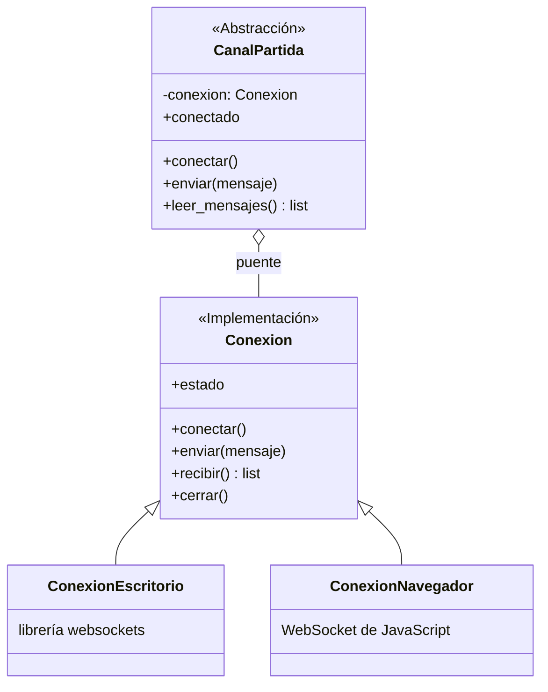

# ADR 0008: Bridge entre el canal de la partida y la conexión WebSocket

- **Categoría:** patrón estructural (secundario)
- **Estado:** Implementado (US-08 y US-25, Sprint 2)
- **Fecha:** 2026-10-25
- **Relacionado:** ADR 0002 (cliente móvil con pygbag), ADR 0004 (Factory), ADR 0007 (Facade)

## Contexto

El mismo cliente corre en dos plataformas (ADR 0002): en la PC con Python normal y en el navegador
del celular compilado con pygbag. Abrir un WebSocket es distinto en cada una: en la PC se usa la
librería `websockets` dentro de una tarea de asyncio, y en el navegador hay que usar el `WebSocket`
de JavaScript, porque `websockets` no existe ahí.

Hay dos cosas que cambian por separado:

- **Lo que el juego hace con el canal:** conectarse a la partida con el token, enviar entradas,
  leer los mensajes de cada cuadro. Esto crece con el juego (en el Sprint 3, chat, eventos o una
  pantalla de espectador).
- **Cómo se transporta:** escritorio o navegador, y quizás otro más adelante (por ejemplo `wss://`
  en la nube o un transporte falso para las pruebas).

Si se resolviera con herencia, habría una clase por combinación (`CanalPartidaEscritorio`,
`CanalPartidaNavegador`, `CanalEspectadorEscritorio`…), que crece multiplicando.

## Decisión

Usar el patrón **Bridge**: separar la **abstracción** (el canal que usa el juego) de la
**implementación** (la conexión de cada plataforma). La abstracción guarda una referencia a la
implementación y le delega el transporte.

| Rol del patrón | Clase en el proyecto | Archivo |
| --- | --- | --- |
| **Abstracción** | `CanalPartida`: arma la URL con el token (`ws://` o `wss://`), `conectar()`, `enviar()`, `leer_mensajes()`, `conectado` | `client/src/realtime_client.py` |
| **Implementación** (interfaz) | `Conexion`: `conectar()`, `enviar()`, `recibir()`, `cerrar()`, `estado` | `client/src/red/websocket.py` |
| **Implementación concreta** | `ConexionEscritorio` (librería `websockets` en asyncio) | `client/src/red/websocket.py` |
| **Implementación concreta** | `ConexionNavegador` (`WebSocket` de JavaScript con pygbag) | `client/src/red/websocket.py` |
| Quien elige la implementación | `crear_conexion(url)` según la plataforma, inyectada en `CanalPartida(fabrica=...)` | `client/src/red/websocket.py` |



```python
class CanalPartida:
    def __init__(self, partida_id, token, fabrica=crear_conexion) -> None:
        self._conexion = fabrica(url_del_canal(partida_id, token))

    def enviar(self, mensaje: dict) -> None:
        self._conexion.enviar(mensaje)
```

**Alcance real.** El Bridge está en el WebSocket. Las peticiones HTTP (`client/src/red/http.py`)
usan un `if EN_NAVEGADOR` dentro de `solicitar()`, porque solo hay una operación y no crece. Si
aparecen más operaciones HTTP distintas por plataforma, se separan igual que `Conexion`.

## Alternativas consideradas

| Alternativa | Por qué no |
| --- | --- |
| `if EN_NAVEGADOR` en cada método del canal | Cada método nuevo repite la condición, y la pantalla de la arena no se podría probar sin una conexión real |
| Una subclase de `CanalPartida` por plataforma | Mezcla las dos dimensiones: cada canal nuevo necesitaría una versión por plataforma |
| Dos clientes distintos (uno de escritorio y uno web) | Descartado en el ADR 0002: duplica todo el cliente |
| Adapter | Adapter se agrega después para hacer encajar algo que ya existe; aquí las dos jerarquías se diseñaron desde el inicio para variar por separado |

## Consecuencias

**Positivas**

- La arena, el lobby y las pruebas usan `CanalPartida` sin saber en qué plataforma corren.
- Una plataforma nueva es una `Conexion` nueva; un uso nuevo del canal no toca las conexiones.
- En las pruebas se inyecta una conexión falsa por `fabrica`: `client/tests/test_canal_partida.py`
  (`test_el_canal_pide_la_conexion_con_la_url_correcta`,
  `test_el_canal_entrega_los_mensajes_y_envia_los_del_juego`); las conexiones reales se prueban en
  `test_red_websocket.py`.
- `test_cargar_las_pantallas_no_importa_librerias_de_escritorio` asegura que el navegador no
  intente cargar `websockets`.

**Negativas**

- Hoy la abstracción tiene una sola clase (`CanalPartida`), así que el beneficio completo se ve
  cuando crezca el lado del juego en el Sprint 3.
- Dos niveles de indirección para enviar un mensaje (canal → conexión).
- **Bridge frente a Adapter:** se parecen en la estructura, pero Bridge se decide desde el diseño
  para separar dos dimensiones; Adapter (ADR 0005) se usa para hacer compatible algo que ya existe.
