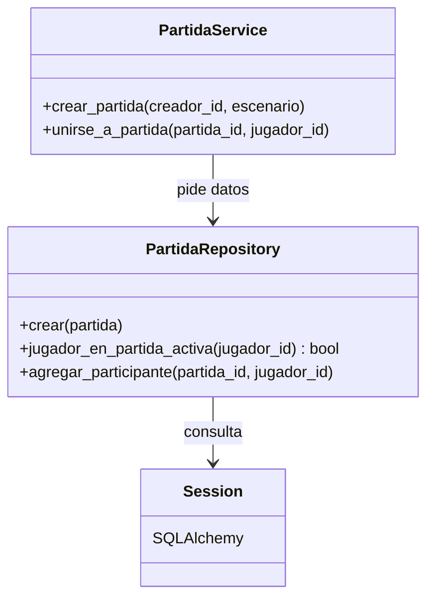

# ADR 0009: Repository para el acceso a los datos

- **Categoría:** patrón de persistencia (Fowler, *Patterns of Enterprise Application Architecture*).
  No es un patrón GoF, así que **no cuenta** para el mínimo de un patrón creacional, uno
  estructural y uno de comportamiento (ADRs 0004, 0005 y 0006).
- **Estado:** Implementado (US-01 a US-08 y US-21, Sprint 2)
- **Fecha:** 2026-10-25
- **Relacionado:** ADR 0003 (arquitectura en capas), ADR 0004 (Factory)

## Contexto

El enunciado sugiere Repository para la "persistencia de usuarios y partidas". El backend está en
capas (ADR 0003): rutas → servicios → repositorios → modelos. Los servicios tienen las reglas de
negocio (por ejemplo RN-04: un jugador no puede estar en dos partidas a la vez) y no deberían
depender de cómo se escribe cada consulta en SQLAlchemy. Además, las reglas se quieren probar sin
levantar el servidor.

## Decisión

Usar **Repository**: una clase por agregado que encapsula las consultas y escrituras en
PostgreSQL. Los servicios piden los datos por intención y no saben cómo se consultan.

| Rol | Clase en el proyecto | Archivo |
| --- | --- | --- |
| Repositorio | `UsuarioRepository`: `crear`, `guardar`, `obtener_por_correo`, `existe_correo`, `estadisticas`… | `server/app/repositories/usuario_repository.py` |
| Repositorio | `PartidaRepository`: `crear`, `listar_disponibles_con_jugadores`, `agregar_participante`, `es_participante`, `jugador_en_partida_activa`… | `server/app/repositories/partida_repository.py` |
| Repositorio | `TokenRepository`: tokens de verificación y recuperación por correo | `server/app/repositories/token_repository.py` |
| Cliente | Servicios: `RegistroService`, `LoginService`, `PartidaService`, `PerfilService`… | `server/app/services/` |
| Entidades | `Usuario`, `Partida`, `Participacion`, `TokenUsuario` | `server/app/models/` |

Cada repositorio recibe la sesión de SQLAlchemy por el constructor, y cada servicio recibe su
repositorio (`PartidaService(PartidaRepository(db))`).

## Alternativas consideradas

| Alternativa | Por qué no |
| --- | --- |
| Consultas de SQLAlchemy dentro de los servicios o de las rutas | Las reglas de negocio quedan mezcladas con el SQL y cada prueba necesita la base de datos |
| Active Record (métodos de consulta en el modelo) | Los modelos quedan con dos responsabilidades (estructura de la tabla y consultas) |
| Un repositorio genérico para todas las tablas | Las consultas útiles son específicas (`jugador_en_partida_activa`); un repositorio genérico las empuja de vuelta a los servicios |

## Consecuencias

**Positivas**

- Las reglas de negocio quedan separadas del SQL (responsabilidad única).
- Los servicios dependen del repositorio que reciben, no de cómo se crea (inversión de
  dependencias).
- Los repositorios se prueban contra PostgreSQL en el CI: `server/tests/test_repositories.py`.
- Cambiar una consulta (por ejemplo, para optimizarla) no toca los servicios.

**Negativas**

- Una clase más por agregado, y algunos métodos son de una sola línea.
- Los repositorios devuelven modelos de SQLAlchemy, así que los servicios sí conocen las entidades
  (no hay una capa de dominio separada). Para el tamaño del proyecto es suficiente.
