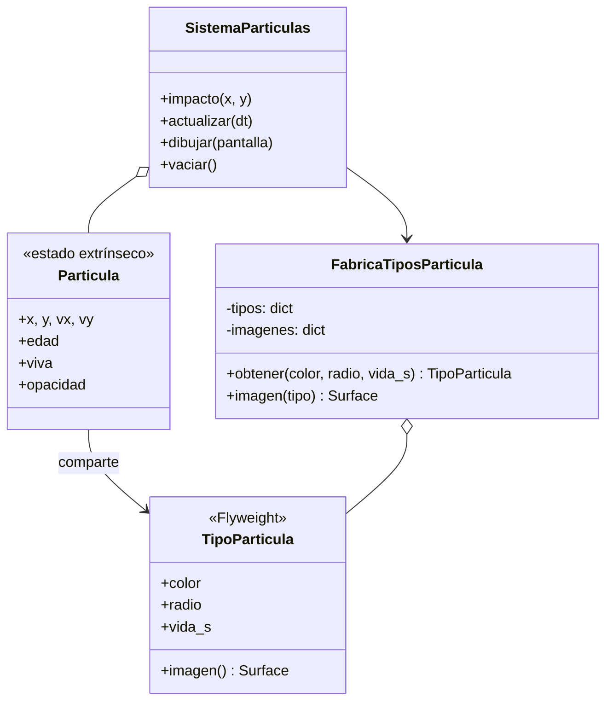

# ADR 0012: Flyweight para las partículas de impacto

- **Categoría:** patrón estructural (secundario)
- **Estado:** Implementado (efectos visuales de la US-29, Sprint 3)
- **Fecha:** 2026-11-23
- **Relacionado:** ADR 0003 (patrones), ADR 0006 (estados del jugador que publica el motor)

## Contexto

Cuando un guardián alcanza a un jugador, el servidor lo deja **aturdido** 3 segundos (ADR 0006).
En la arena eso solo se notaba porque el personaje se ponía gris. Para que el golpe se vea, el
cliente lanza una explosión de chispas y una onda en el punto del impacto.

Cada impacto crea unas 28 partículas, y con 4 jugadores y varios guardianes puede haber más de 100
en pantalla a 30 cuadros por segundo. Casi todo lo que describe una partícula se repite: solo hay
5 combinaciones de color, tamaño y duración. Si cada partícula guardara su propia imagen, se
dibujaría la misma bolita cientos de veces y cada objeto ocuparía mucho más de lo necesario.

## Decisión

Usar el patrón **Flyweight**: separar el estado **intrínseco** (compartido, no cambia) del
**extrínseco** (propio de cada partícula, cambia en cada cuadro).

| Rol del patrón | Clase en el proyecto | Qué guarda |
| --- | --- | --- |
| **Flyweight** | `TipoParticula` (dataclass inmutable) | Color, radio y duración; sabe dibujar su imagen |
| **Fábrica de flyweights** | `FabricaTiposParticula` | Entrega siempre el mismo `TipoParticula` para los mismos datos y guarda su imagen ya dibujada |
| **Contexto** (estado extrínseco) | `Particula` | Posición, velocidad, edad y una referencia a su tipo |
| **Cliente** | `SistemaParticulas` | Crea las partículas de cada impacto, las mueve, las dibuja y borra las que se apagaron |

Todo está en `client/src/screens/particulas.py`. La arena (`client/src/screens/arena.py`) compara
el estado de cada jugador con el del cuadro anterior: cuando pasa a `aturdido`, llama a
`particulas.impacto(x, y)`. No hizo falta cambiar el servidor ni el protocolo.



```python
self._tipos_impacto = [
    self.fabrica.obtener(MORADO, 3, 0.7),
    self.fabrica.obtener(LILA, 2, 0.6),
    ...
]
# cada partícula solo apunta a uno de esos 5 tipos
Particula(x, y, vx, vy, tipo)
```

Al dibujar, la imagen compartida recibe la opacidad de cada partícula justo antes de pintarla
(`set_alpha`), así una sola imagen sirve para todas las partículas de ese tipo.

## Alternativas consideradas

| Alternativa | Por qué no |
| --- | --- |
| Cada partícula guarda color, tamaño y su propia `Surface` | Cientos de imágenes iguales; se repite el dibujo en cada impacto |
| Dibujar círculos con `pygame.draw` en cada cuadro | Sirve, pero no permite opacidad sin crear una superficie por partícula y cuadro |
| Una animación pregrabada (spritesheet) | Siempre se vería igual; con partículas cada golpe sale distinto y se adapta a la posición |
| Prototype (clonar una partícula modelo) | Clonar copia todo el estado; aquí lo que interesa es **no** copiar lo repetido sino compartirlo |

## Consecuencias

**Positivas**

- Por más impactos que haya, solo existen 5 `TipoParticula` y 5 imágenes; cada `Particula` guarda
  5 números y una referencia.
- Agregar otro efecto (por ejemplo al recoger celdas o al completar un reto) es pedirle tipos nuevos
  a la fábrica, sin tocar `Particula`.
- La lógica no depende de la ventana: el azar (`random.Random`) y el tiempo se inyectan, así que se
  prueba sin pantalla. Pruebas en `client/tests/test_particulas.py`:
  `test_la_fabrica_reutiliza_el_mismo_tipo_para_los_mismos_datos`,
  `test_muchas_particulas_comparten_pocos_tipos`, `test_las_chispas_se_desvanecen_y_desaparecen` y,
  con la arena, `test_cuando_un_guardian_alcanza_al_jugador_salen_chispas` y
  `test_seguir_aturdido_no_lanza_mas_chispas`.

**Negativas**

- Con tan pocas partículas el ahorro de memoria es pequeño; el beneficio principal es no redibujar
  las imágenes y tener el efecto ordenado y probado.
- Como la imagen es compartida, hay que ajustarle la opacidad justo antes de cada `blit`; si alguien
  la usara en otro lado sin ajustarla, saldría con la opacidad de la última partícula.
- El efecto depende de que el cliente vea el cambio a `aturdido`; si se pierde un cuadro justo en
  ese momento no hay chispas (el golpe sigue contando en el servidor).
