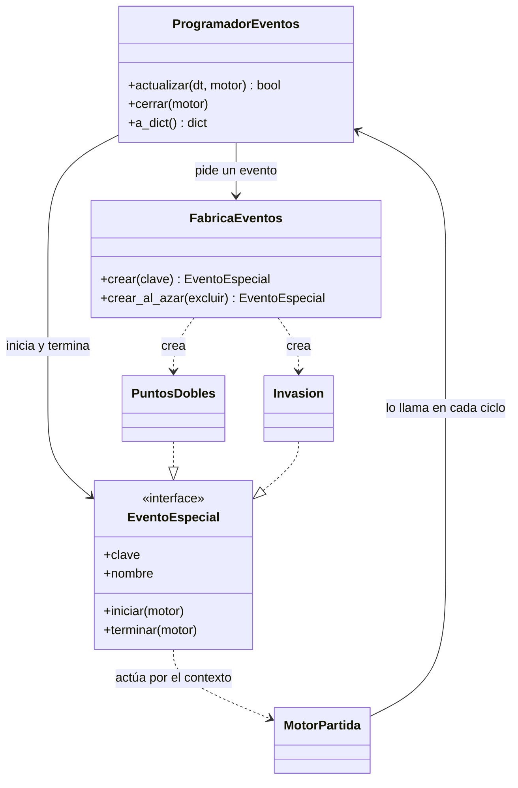

# ADR 0013: Eventos especiales con Factory y un programador

- **Categoría:** patrón creacional (Factory) y organización del motor
- **Estado:** Implementado (US-16, Sprint 3)
- **Fecha:** 2026-11-24
- **Relacionado:** ADR 0004 (Factory), ADR 0006 (Observer del motor), ADR 0011 (acciones del
  contexto)

## Contexto

El enunciado pide eventos especiales durante la partida. El ADR 0004 ya anticipaba que la fábrica
serviría para "guardianes, eventos especiales y bonificaciones", porque hay varios productos con
una interfaz común.

Se implementaron dos eventos:

- **Puntos dobles:** durante 10 s todo lo que se gana vale el doble.
- **Invasión:** durante 10 s aparecen dos guardianes perseguidores cerca del reactor.

Lo que se necesita: que cada evento empiece y termine solo, que sus efectos **desaparezcan al
terminar** (también si la partida termina a la mitad), que no haya dos a la vez ni el mismo dos
veces seguidas, y que agregar un evento nuevo no obligue a tocar el motor.

## Decisión

Tres piezas en `server/app/realtime/eventos_especiales.py`:

| Pieza | Clase | Qué hace |
| --- | --- | --- |
| Producto | `PuntosDobles`, `Invasion` | Cada evento tiene `clave`, `nombre`, `iniciar(motor)` y `terminar(motor)`. `terminar` deshace todo lo que hizo `iniciar` |
| Fábrica (Factory) | `FabricaEventos` | Crea el evento por su clave y elige uno al azar, sin repetir el último |
| Programador | `ProgramadorEventos` | Lleva el reloj: primer evento a los 30 s, duración de 10 s, espera de 30 a 45 s entre eventos. El motor lo llama en cada ciclo |

Los eventos no conocen al `MotorPartida`: reciben un **contexto** (`ContextoEvento`) con lo mínimo
que pueden hacer: cambiar el multiplicador de puntos, agregar o quitar un guardián, consultar las
posiciones de los jugadores y publicar un evento. El motor cumple esa interfaz.

El motor aplica el multiplicador solo a los puntos que se ganan (`sumar_puntaje`); las
penalizaciones no se duplican. El programador es opcional: sin él el motor no tiene eventos, así
las pruebas del resto del motor no cambian.

El estado de la partida trae `partida.evento` (`clave`, `nombre`, `restante`) solo mientras hay un
evento, y el cliente lo muestra en el cuadro de posiciones. El inicio y el fin se publican como
`evento_especial_iniciado` y `evento_especial_finalizado` y se guardan en la tabla `eventos`
(ADR 0006).

## Alternativas consideradas

| Alternativa | Por qué se descartó |
| --- | --- |
| Poner los eventos con `if` dentro del motor | Cada evento nuevo obligaría a editar el motor y a repetir la lógica de "deshacer al terminar" |
| Un evento por jugador | El enunciado habla de eventos de la partida: afectan a todos por igual |
| Que cada evento tenga su propio reloj | Dos relojes podrían solaparse; un solo programador garantiza uno a la vez |

## Consecuencias

- Agregar un evento nuevo es una clase con `iniciar` y `terminar` más una línea en la fábrica.
- Que `terminar` deshaga todo se prueba en `server/tests/test_eventos_especiales.py`, también
  cuando la partida termina a mitad del evento.
- Puntos dobles también duplica los puntos de los retos (US-27), porque pasan por la misma suma.
  Los logros no cambian: cuentan la energía del reactor, no los puntos.
- Los tiempos (30 s, 10 s, 30 a 45 s) son constantes del archivo; si el profe pide otros, se
  cambian ahí.