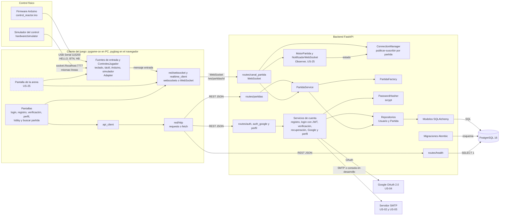

# Diagrama de componentes

Componentes del sistema y las interfaces por las que se comunican. Las cajas con borde punteado
están planificadas (todavía no están en `develop`).

## Componentes

| Componente | Responsabilidad | Código | Estado |
| --- | --- | --- | --- |
| Firmware Arduino | Lee los 5 botones (D2–D6) con antirrebote y envía cambios por Serial | `hardware/firmware/control_reactor/` | Implementado |
| Simulador del control | Ventana con los 5 botones que envía las mismas líneas por un socket local | `hardware/simulator/` | Implementado |
| Fuentes de entrada | Convierten teclado, táctil, Serial y simulador en `(control, estado)` (Adapter); `ControlesJugador` las envía al canal con el mensaje `entrada` | `client/src/entrada/` | Implementado (AB#40) |
| Pantallas | Login, registro, verificación de correo, recuperación, perfil, lobby y buscar o unirse a partidas; llaman a la API desde tareas async sin congelar la ventana | `client/src/screens/` | Implementado |
| Pantalla de la arena | Dibuja la arena con el estado que manda el servidor y usa `ControlesJugador` | — | En curso (US-25) |
| `api_client` | Funciones async por endpoint; traduce errores de la API a mensajes | `client/src/api_client.py` | Implementado |
| `red/http` | HTTP en escritorio (`requests` en un hilo) y en el navegador (`fetch`) | `client/src/red/http.py` | Implementado |
| `red/websocket` y `realtime_client` | WebSocket en escritorio y en el navegador, y canal de la partida que usan las pantallas | `client/src/red/websocket.py`, `client/src/realtime_client.py` | Implementado (US-08) |
| Rutas REST | Validan las peticiones y traducen errores a códigos HTTP | `server/app/api/routes/` | `auth` (registro, login, verificación y recuperación), `auth_google`, `perfil`, `partidas` (crear, listar y unirse) y `health` |
| Canal de la partida | WebSocket por partida: verifica que el jugador participe y lo suscribe al canal | `server/app/api/routes/canal_partida.py` | Implementado (US-08) |
| `ConnectionManager` | Guarda los jugadores conectados a cada partida y les difunde los mensajes (publicar-suscribir) | `server/app/realtime/connection_manager.py` | Implementado (US-08) |
| `MotorPartida` y `NotificadorWebSocket` | Aplica entradas, mueve jugadores cada 50 ms y avisa a los observadores; el notificador publica el estado en el canal | `server/app/realtime/` | Implementado (US-25; ver ADR 0006) |
| Servicios | Reglas de negocio | `server/app/services/` | Cuenta (registro, login, verificación, recuperación, Google, perfil y correo) y partidas (`PartidaService`, `PartidaFactory`) |
| `PasswordHasher` | Hash y verificación de contraseñas con scrypt | `server/app/core/security.py` | Implementado |
| Repositorios | Acceso a datos (Repository) | `server/app/repositories/` | Implementado |
| Modelos y migraciones | Tablas en SQLAlchemy y versiones del esquema en Alembic | `server/app/models/`, `server/alembic/` | Implementado |
| PostgreSQL | Usuarios, partidas, participaciones, eventos y ranking | Contenedor `db` | Implementado |
| Google OAuth | Inicio de sesión con Google: crea la cuenta o la vincula por correo | `server/app/services/google_oauth.py` | Implementado (US-04) |
| Servidor SMTP | Correos de verificación y recuperación de contraseña; sin SMTP configurado se muestran en la consola del servidor | `server/app/services/correo.py` | Implementado (US-02, US-05) |

## Interfaces

| Interfaz | Entre | Formato | Definida en |
| --- | --- | --- | --- |
| Serial | Arduino → cliente | Líneas ASCII a 115200 baudios: `HELLO`, `BTN <botón> PRESS/RELEASE`, `HB` | `docs/contrato-api-hardware.md`, capa 1 |
| Socket local | Simulador → cliente | Las mismas líneas por `socket://localhost:7777` | `hardware/simulator/README.md` |
| REST | Cliente → backend | JSON: cuenta (`/auth/registro`, `/auth/login`, `/auth/yo`, verificación, recuperación, `/auth/google/...`, `/perfil`), partidas (`POST /partidas`, `GET /partidas`, `POST /partidas/{id}/unirse`) y `/health` | Documentación interactiva en `/docs` |
| WebSocket | Cliente ↔ backend | JSON con campo `tipo`: `entrada`, `dispositivo`, `error`, estado de la partida | `docs/contrato-api-hardware.md`, capa 2 |
| SQL | Backend → PostgreSQL | SQLAlchemy con `psycopg` | `server/app/db/session.py` |

Para el servidor no hay diferencia entre teclado, táctil, control físico o simulador: todos llegan
como el mismo mensaje `entrada`, con `origen` solo informativo.
