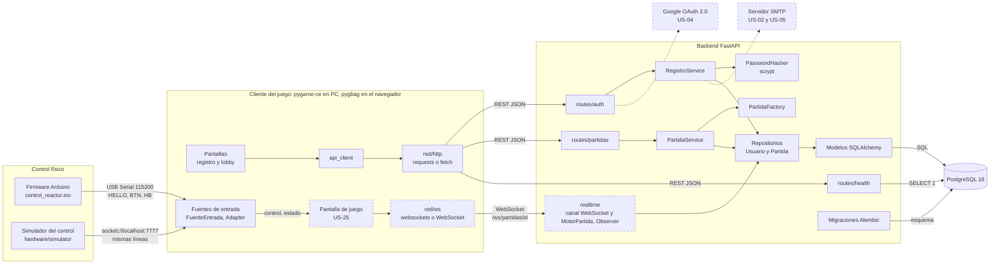

# Diagrama de componentes

Componentes del sistema y las interfaces por las que se comunican. Las cajas con borde punteado
están planificadas (todavía no están en `develop`).

## Componentes

| Componente | Responsabilidad | Código | Estado |
| --- | --- | --- | --- |
| Firmware Arduino | Lee los 5 botones (D2–D6) con antirrebote y envía cambios por Serial | `hardware/firmware/control_reactor/` | Implementado |
| Simulador del control | Ventana con los 5 botones que envía las mismas líneas por un socket local | `hardware/simulator/` | Implementado |
| Fuentes de entrada | Convierten teclado, táctil, Serial y simulador en `(control, estado)` (Adapter) | `client/src/entrada/` | Serial y simulador implementados; teclado y táctil en `prototipos/cliente-movil/` |
| Pantallas | Interfaz de registro y lobby; llaman a la API desde tareas async sin congelar la ventana | `client/src/screens/` | Implementado |
| Pantalla de juego | Dibuja la arena y envía las entradas por WebSocket | — | Planificado (US-25) |
| `api_client` | Funciones async por endpoint; traduce errores de la API a mensajes | `client/src/api_client.py` | Implementado |
| `red/http` | HTTP en escritorio (`requests` en un hilo) y en el navegador (`fetch`) | `client/src/red/http.py` | Implementado |
| `red/ws` | WebSocket en escritorio y en el navegador | `prototipos/cliente-movil/red.py` | Probado en el prototipo; pasa al cliente con US-25 |
| Rutas REST | Validan las peticiones y traducen errores a códigos HTTP | `server/app/api/routes/` | `auth` (registro), `partidas` (crear) y `health` |
| `realtime` | Canal WebSocket por partida y motor de partida con observadores | `server/app/realtime/` | Planificado (US-08, US-25; ver ADR 0003) |
| Servicios | Reglas de negocio | `server/app/services/` | `RegistroService`, `PartidaService`, `PartidaFactory` |
| `PasswordHasher` | Hash y verificación de contraseñas con scrypt | `server/app/core/security.py` | Implementado |
| Repositorios | Acceso a datos (Repository) | `server/app/repositories/` | Implementado |
| Modelos y migraciones | Tablas en SQLAlchemy y versiones del esquema en Alembic | `server/app/models/`, `server/alembic/` | Implementado |
| PostgreSQL | Usuarios, partidas, participaciones, eventos y ranking | Contenedor `db` | Implementado |
| Google OAuth | Inicio de sesión con Google | — | Planificado (US-04) |
| Servidor SMTP | Correos de verificación y recuperación de contraseña | — | Planificado (US-02, US-05) |

## Interfaces

| Interfaz | Entre | Formato | Definida en |
| --- | --- | --- | --- |
| Serial | Arduino → cliente | Líneas ASCII a 115200 baudios: `HELLO`, `BTN <botón> PRESS/RELEASE`, `HB` | `docs/contrato-api-hardware.md`, capa 1 |
| Socket local | Simulador → cliente | Las mismas líneas por `socket://localhost:7777` | `hardware/simulator/README.md` |
| REST | Cliente → backend | JSON: `POST /auth/registro`, `POST /partidas`, `GET /health`, `GET /health/db` | Documentación interactiva en `/docs` |
| WebSocket | Cliente ↔ backend | JSON con campo `tipo`: `entrada`, `dispositivo`, `error`, estado de la partida | `docs/contrato-api-hardware.md`, capa 2 |
| SQL | Backend → PostgreSQL | SQLAlchemy con `psycopg` | `server/app/db/session.py` |

Para el servidor no hay diferencia entre teclado, táctil, control físico o simulador: todos llegan
como el mismo mensaje `entrada`, con `origen` solo informativo.
