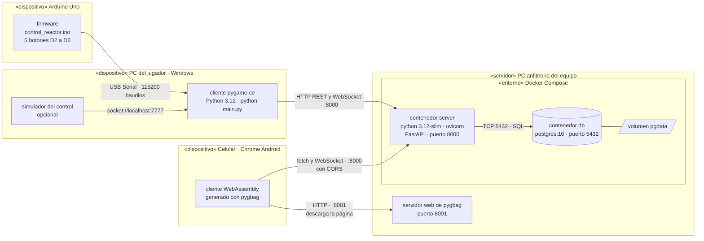
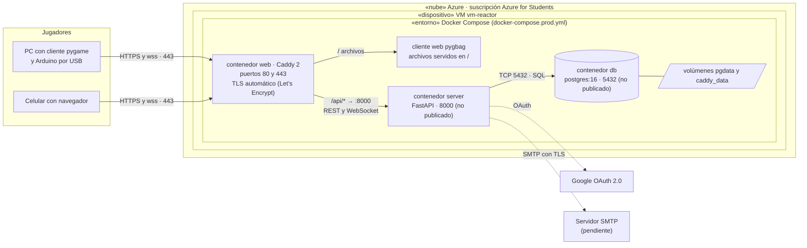
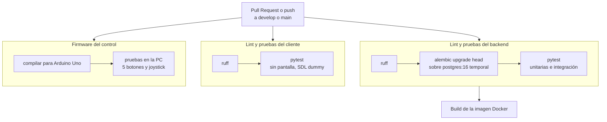
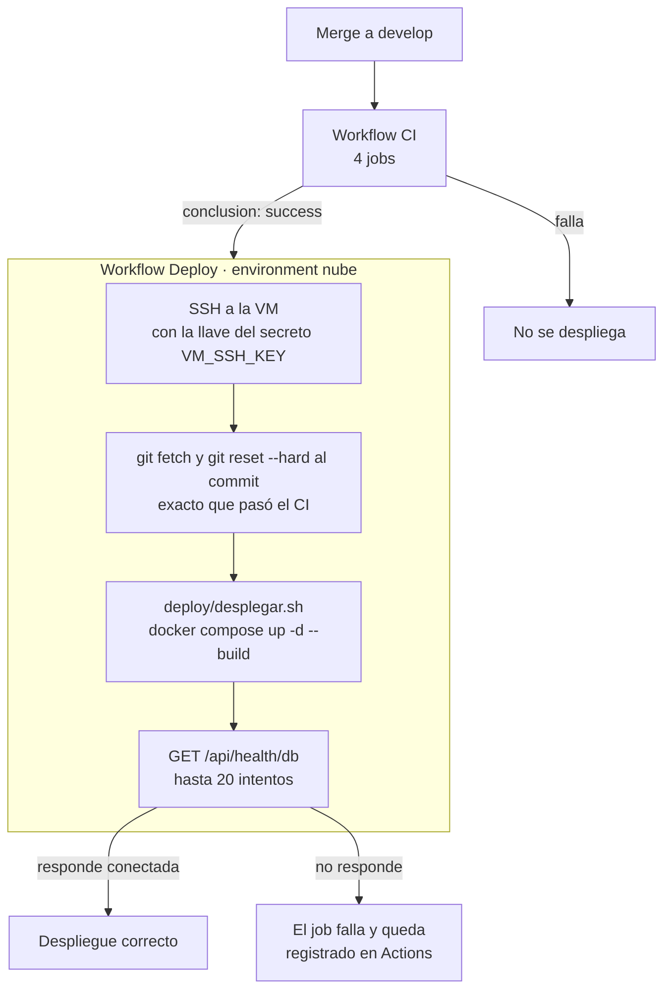

# Vista de despliegue

Dónde corre cada componente y cómo se conectan los nodos.

## Sprint 2: red local (desarrollo y demostración)

Todo corre en la red WiFi del equipo. El backend y la base de datos van en contenedores con
Docker Compose; el cliente corre en la PC de cada jugador o en el navegador del celular.

| Nodo | Software | Cómo se levanta |
| --- | --- | --- |
| Arduino Uno | `hardware/firmware/control_reactor/control_reactor.ino` | Se carga con Arduino IDE; se conecta por USB a la PC del jugador |
| PC del jugador | Python 3.12, `pygame-ce`, `requests`, `pyserial` | `cd client && python main.py` |
| Celular | Navegador con el cliente compilado por pygbag | Abrir `http://<IP de la PC anfitriona>:8001` en la misma red |
| PC anfitriona | Docker Desktop y pygbag | `docker compose up --build` y `pygbag --bind <IP real> --port 8001 .` dentro de `client/` |
| Contenedor `server` | Imagen de `server/Dockerfile` | Lo levanta Compose cuando `db` pasa el healthcheck |
| Contenedor `db` | `postgres:16` con volumen `pgdata` | Lo levanta Compose; los datos sobreviven a reinicios |

Notas:

- El Arduino siempre se conecta a la PC del jugador, no al servidor (contrato de hardware). En el
  celular no hay control físico: se juega con botones táctiles.
- La PC anfitriona puede ser la misma PC de un jugador.
- `pygbag --bind` necesita la IP real de la PC, no `0.0.0.0` (ADR 0002).
- Las variables de entorno van en `.env` (plantilla en `.env.example`); el `.env` no se sube al
  repositorio.

## Sprint 3: despliegue en la nube (implementado)

Desplegado desde el 13/11/2026 en **https://control-reactor.northcentralus.cloudapp.azure.com**.
La decisión y sus alternativas están en el [ADR 0010](../adr/0010-despliegue-en-la-nube.md); los
pasos de operación, en [`docs/despliegue.md`](../despliegue.md).

| Nodo | Software | Notas |
| --- | --- | --- |
| VM `vm-reactor` | Ubuntu 24.04, Docker, 2 GB de swap | Grupo de recursos `rg-control-reactor`; usuario `reactor` |
| Contenedor `web` | Caddy 2 (`deploy/Caddyfile`, `deploy/web.Dockerfile`) | Único que publica puertos: 80 y 443. Saca y renueva el certificado solo |
| Contenedor `server` | La misma imagen de `server/Dockerfile` | Sin `--reload`, con `--proxy-headers`. Corre `alembic upgrade head` al arrancar |
| Contenedor `db` | `postgres:16`, volumen `pgdata` | No accesible desde fuera de la VM |
| Cliente web | Compilado con pygbag dentro de la imagen de Caddy | Es el mismo código del cliente de escritorio (ADR 0002) |

**Decisiones de red y configuración:**

- Puertos públicos: **solo 22, 80 y 443**. El 8000 y el 5432 quedan cerrados; se llega a ellos
  únicamente desde la red interna de Docker.
- **Un solo origen:** la página y la API comparten dominio, con la API bajo `/api`. Así no hay
  contenido mixto ni CORS entre dominios, y el WebSocket viaja por `wss://` (ADR 0002).
- El cliente resuelve su URL en `url_backend_web()` (`client/src/config.py`): con `https` usa
  `https://<host>/api`; con `http` (pygbag en la red local) sigue usando el puerto 8000.
- `CORS_ORIGENES` en producción es el dominio del cliente, ya no `*`.
- El `.env` de producción vive solo en la VM y no está en el repositorio.
- Dominio gratuito de Azure (`*.cloudapp.azure.com`) por la etiqueta DNS de la IP pública.

## Pipeline de CI

Cada Pull Request y cada push a `develop` o `main` corre `.github/workflows/ci.yml` en GitHub
Actions. Los cuatro jobs se configuran como checks requeridos en la ruleset de `develop`.

## Pipeline de entrega continua

Al mergear a `develop`, el CI corre primero; si termina en verde, se dispara el despliegue
(`.github/workflows/deploy.yml`). Si el CI falla, no se despliega nada.

- Secretos del repositorio: `VM_HOST` (dominio), `VM_USER` y `VM_SSH_KEY` (llave usada solo por el
  workflow, distinta de la llave personal).
- Se despliega **desde `develop`** y no solo desde `main`, para que la nube tenga siempre lo último
  y el despliegue se ejercite varias veces antes de la demo (ADR 0010).
- Se despliega el **commit exacto** que pasó el CI, no la punta de la rama: lo probado y lo
  desplegado son lo mismo.
- También se puede lanzar a mano desde Actions con **Run workflow**.
- Volver a una versión anterior: en la VM, `git reset --hard <commit>` y `./deploy/desplegar.sh`.
