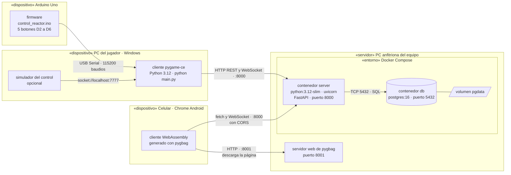
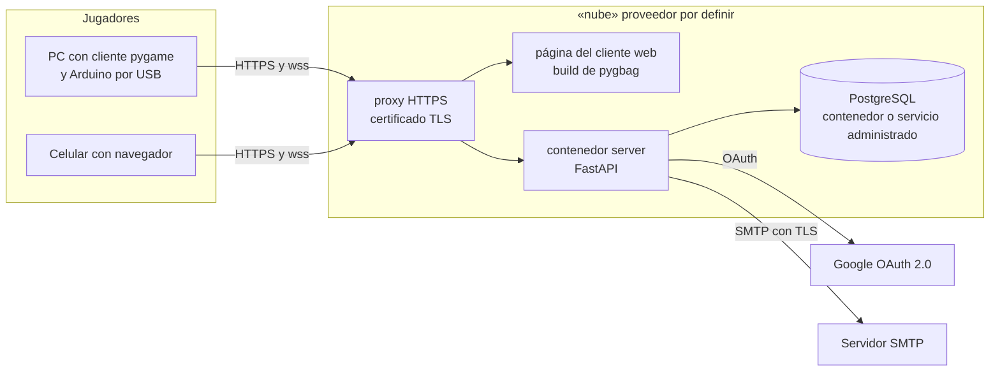
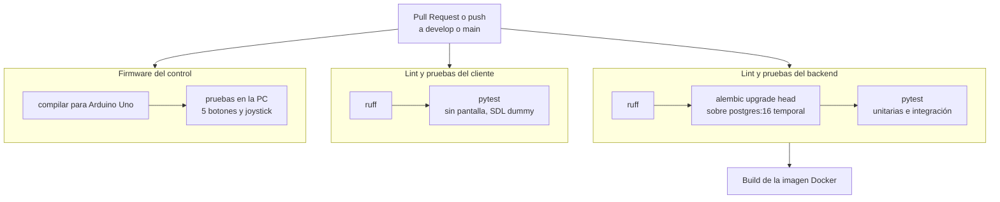

# Vista de despliegue

Dónde corre cada componente y cómo se conectan los nodos.

## Sprint 2: red local (desarrollo y demostración)

Todo corre en la red WiFi del equipo. El backend y la base de datos van en contenedores con
Docker Compose; el cliente corre en la PC de cada jugador o en el navegador del celular.

| Nodo | Software | Cómo se levanta |
| --- | --- | --- |
| Arduino Uno | `hardware/firmware/control_reactor/control_reactor.ino` | Se carga con Arduino IDE; se conecta por USB a la PC del jugador |
| PC del jugador | Python 3.12, `pygame-ce`, `requests`, `pyserial` | `cd client && python main.py` |
| Celular | Navegador con el cliente compilado por pygbag | Abrir `http://<IP de la PC anfitriona>:8001` en la misma red |
| PC anfitriona | Docker Desktop y pygbag | `docker compose up --build` y `pygbag --bind <IP real> --port 8001 .` dentro de `client/` |
| Contenedor `server` | Imagen de `server/Dockerfile` | Lo levanta Compose cuando `db` pasa el healthcheck |
| Contenedor `db` | `postgres:16` con volumen `pgdata` | Lo levanta Compose; los datos sobreviven a reinicios |

Notas:

- El Arduino siempre se conecta a la PC del jugador, no al servidor (contrato de hardware). En el
  celular no hay control físico: se juega con botones táctiles.
- La PC anfitriona puede ser la misma PC de un jugador.
- `pygbag --bind` necesita la IP real de la PC, no `0.0.0.0` (ADR 0002).
- Las variables de entorno van en `.env` (plantilla en `.env.example`); el `.env` no se sube al
  repositorio.

## Sprint 3: despliegue en la nube (propuesto)

El enunciado pide despliegue en la nube. El proveedor está por definir; esta es la forma que debe
tener sin importar cuál se elija.

- Si la página se sirve por HTTPS, el navegador exige `wss://` para el WebSocket, así que el
  backend necesita certificado TLS (ADR 0002).
- `CORS_ORIGENES` deja de ser `*` y pasa a ser el dominio del cliente web.
- La imagen del backend es la misma que construye el CI.

## Pipeline de CI

Cada Pull Request y cada push a `develop` o `main` corre `.github/workflows/ci.yml` en GitHub
Actions. Los cuatro jobs se configuran como checks requeridos en la ruleset de `develop`.

