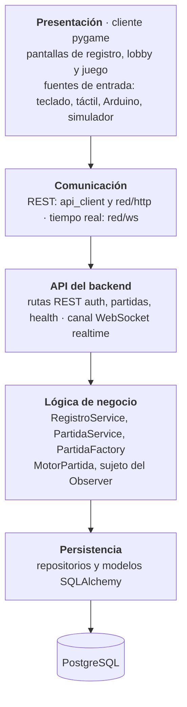
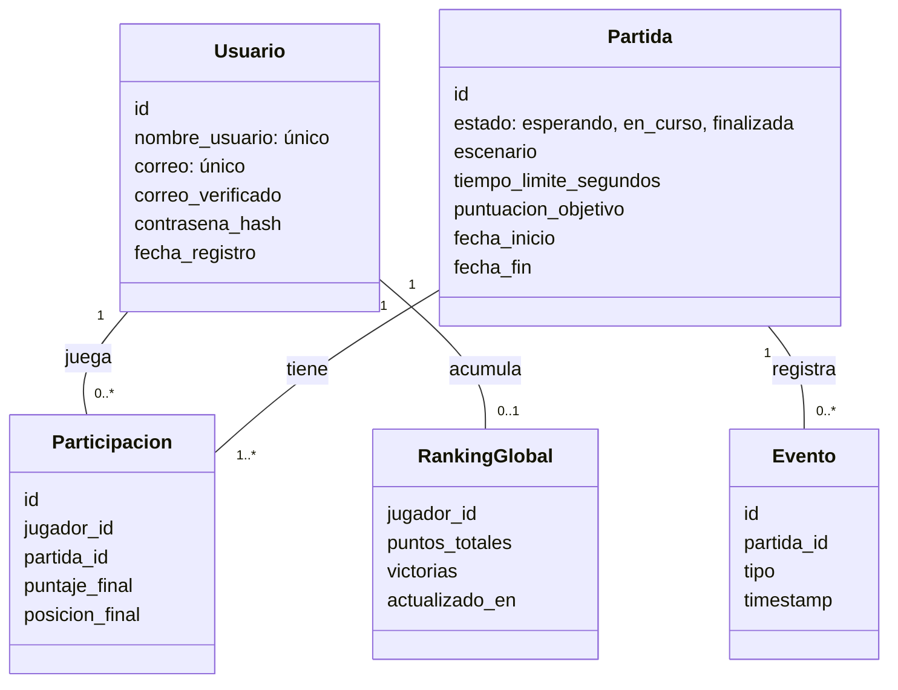
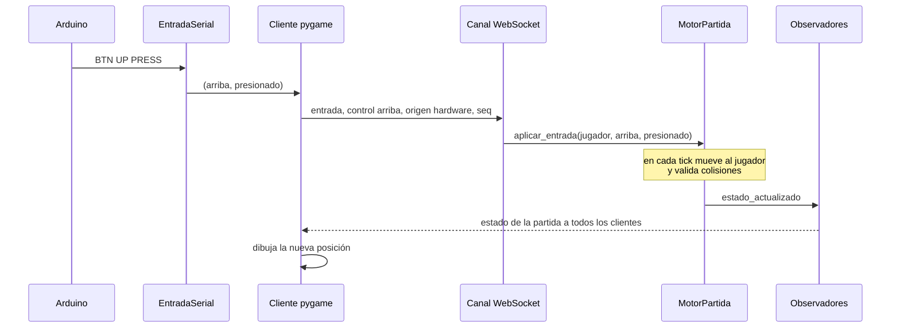

# Vista lógica

Cómo está organizado el sistema por responsabilidades, independientemente de dónde corre cada
parte. Los patrones están justificados en el ADR 0003 (arquitectura) y en los ADRs 0004 a 0009 (diseño).

## Capas del sistema

| Capa | Qué hace | Qué no hace |
| --- | --- | --- |
| Presentación | Dibuja, lee entradas y muestra lo que manda el servidor | No decide movimientos, puntajes ni ganador |
| Comunicación | Habla con el backend igual en escritorio y en navegador (ADR 0002) | No conoce las pantallas |
| API | Valida peticiones con Pydantic y traduce errores a códigos HTTP o mensajes `error` | No tiene reglas de negocio ni SQL |
| Lógica de negocio | Aplica las reglas (RN-01, RN-04…), crea partidas y mueve el juego | No conoce HTTP ni WebSocket |
| Persistencia | Lee y escribe en PostgreSQL | No decide nada del juego |

Cada capa solo depende de la de abajo, y en el backend las dependencias se inyectan (la sesión
con `Depends(get_session)`, el repositorio y la fábrica por el constructor del servicio).

## Modelo de datos

Tablas actuales (`server/app/models/`, migración inicial en `server/alembic/versions/`).

Reglas que el modelo ayuda a cumplir:

- **RN-01:** `correo` y `nombre_usuario` son únicos en la base de datos, además de la validación
  del servicio.
- **RN-04:** un jugador no puede estar en dos partidas activas (`esperando` o `en_curso`); lo
  revisa `PartidaRepository.jugador_en_partida_activa`.
- El historial de partidas sale de `Participacion` y el top 10 de `RankingGlobal`.

## Flujo de una entrada del control físico

Cómo viaja un botón presionado hasta la pantalla de todos los jugadores. La parte del servidor
se implementa con US-08 y US-25.

Si el Arduino deja de enviar latidos (`HB`) durante 3 s, `EntradaSerial` suelta los controles
presionados y el cliente envía `dispositivo: desconectado`, como define el contrato de hardware.
