# Manual de usuario — Control del Reactor

> También en la Wiki del proyecto: sección Manuales.

**Para quién es:** cualquier persona que quiera jugar Control del Reactor, en la compu o en el celular. No hace falta saber de programación.

**Dónde se juega:** https://control-reactor.northcentralus.cloudapp.azure.com (celular o navegador), o con el cliente de escritorio para usar el control físico (ver [Manual técnico](manual-tecnico.md)).

> 📷 = lugar para una captura de la demo interna del 25/11.

## 1. De qué se trata

Hasta 4 jugadores compiten en una arena con un **reactor de energía** en el centro. Gana quien junte más puntos antes de que se acabe el tiempo (5 minutos) o quien llegue primero a 500 puntos. En el camino hay obstáculos, trampas, guardianes que te persiguen y eventos especiales.

## 2. Crear una cuenta

1. En la pantalla de inicio tocá **Crear cuenta**.
2. Escribí un **nombre de usuario** (de 3 a 30 letras, números o guion bajo), tu **correo** y una **contraseña** de al menos 8 caracteres con una letra y un número. En el celular, al tocar cada campo se abre el teclado del teléfono.
3. Te llega un correo **"Verificá tu cuenta de Control del Reactor"**. Abrí el enlace (vence en 24 horas). Si no llega, revisá spam o tocá **Reenviar correo**.
4. Ya podés iniciar sesión.

El correo y el nombre de usuario no se pueden repetir: si ya están registrados, el juego te avisa.

📷 *Registro en el celular con el teclado abierto.*

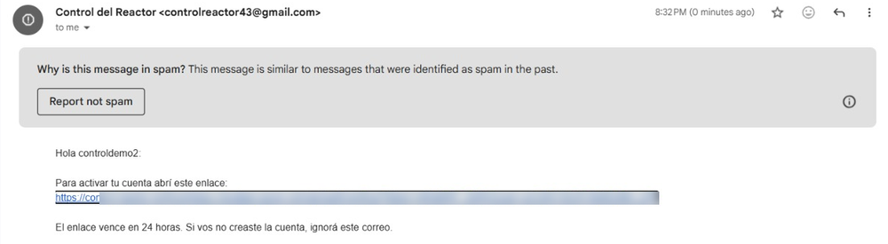

*El correo de verificación (a veces llega a Spam).*

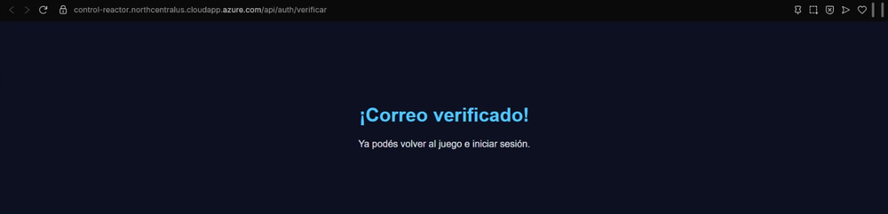

*Al abrir el enlace: correo verificado.*

## 3. Iniciar sesión

- **Con tu cuenta:** escribí tu usuario o correo y la contraseña, y tocá **Entrar**.
- **Con Google:** tocá **Entrar con Google** y elegí tu cuenta en la ventana que se abre. Si es la primera vez, se crea tu cuenta con los datos de Google.
- **Si olvidaste la contraseña:** tocá **Olvidé mi clave**, escribí el correo de tu cuenta, y con el código que te llega elegí una contraseña nueva.

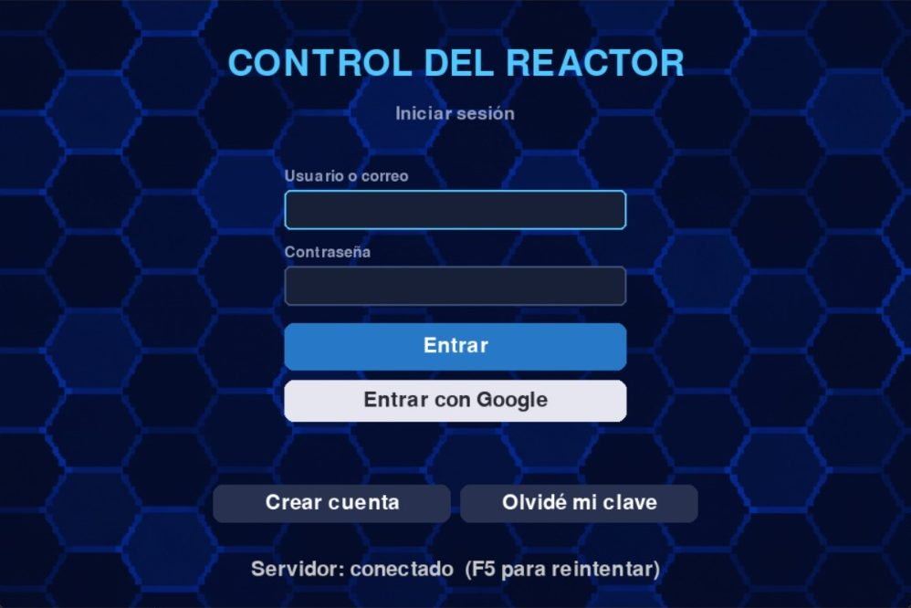

*Pantalla de inicio de sesión.*

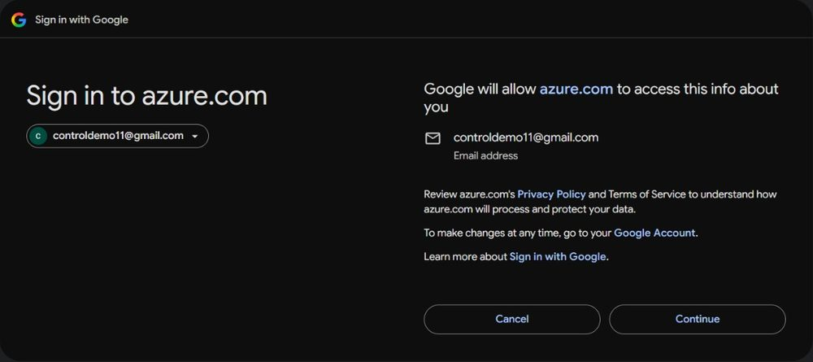

*Al tocar Entrar con Google se abre la ventana de Google para elegir la cuenta.*

## 4. El lobby

Es la pantalla principal después de entrar. Desde ahí podés:

| Botón | Para qué |
| --- | --- |
| **Crear partida** | Abre una partida nueva y te deja como creador |
| **Buscar partidas** | Lista las partidas que esperan jugadores; tocá **Unirse** en la que quieras |
| **Ranking** | Top 10 de jugadores con medallas para los tres primeros; tu fila sale resaltada |
| **Historial** | Tus últimas partidas con puesto y puntaje, tus estadísticas y tus logros |
| **Mi perfil** | Cambiar avatar, descripción y contraseña |
| **Administración** | Solo aparece en la cuenta de administrador (ver sección 9) |
| **Cerrar sesión** | Salir de tu cuenta |

Un jugador solo puede estar en una partida a la vez.

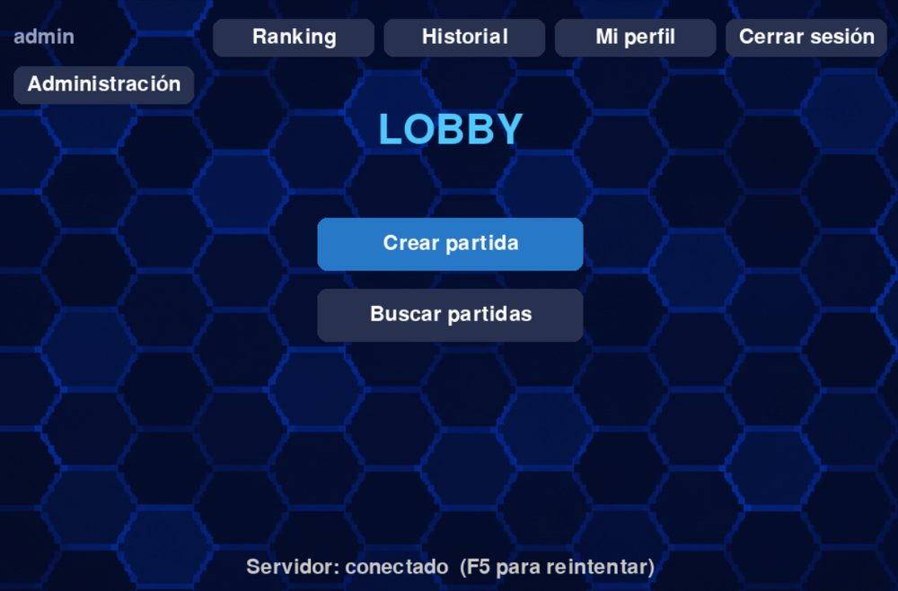

*El lobby (en la cuenta de administrador aparece además el botón Administración).*

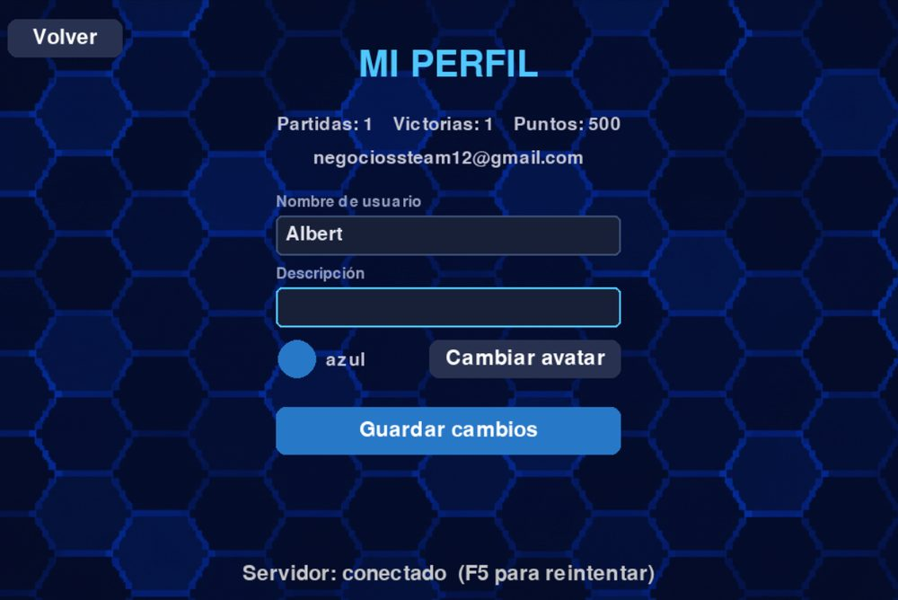

*Mi perfil: estadísticas, nombre, descripción, avatar y guardar cambios.*

## 5. Empezar una partida

1. El creador toca **Crear partida**. Aparece el botón gris **Esperando jugadores (1/2)**.
2. Los demás tocan **Buscar partidas** → **Unirse**. En el lobby del creador crece la lista de conectados.
3. Con al menos 2 jugadores conectados, el botón se pone azul: el creador toca **Iniciar partida** y todos pasan a la arena a la vez. El reloj arranca en 5:00.

Mientras esperan, cualquiera puede tocar **Entrar a la arena** para practicar: lo que pase ahí **no cuenta**. Para salir de la práctica, tocá **Volver al lobby** (arriba a la izquierda) o Esc en la compu. Si el creador inicia mientras estás practicando, el juego te pone en tu punto de inicio con 0 puntos.

En el celular, al primer toque el juego pasa a pantalla completa (en Android; Safari del iPhone no lo permite).

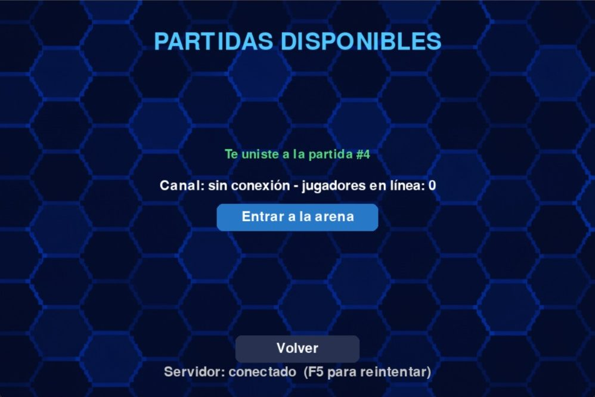

*Después de tocar Unirse: "Te uniste a la partida" y el botón Entrar a la arena.*

📷 *Botón gris "Esperando jugadores" y luego azul "Iniciar partida".*

## 6. Cómo se juega

### Controles

| Dónde | Moverse | Acción |
| --- | --- | --- |
| Compu | Flechas o W A S D | Espacio |
| Celular | Flechas en pantalla (abajo a la izquierda) | Botón de acción en pantalla |
| Control físico | Botones arriba, abajo, izquierda y derecha | Botón de acción |

Otras teclas en la compu: **M** silencia o activa la música y los sonidos; **Esc** vuelve al lobby durante la práctica.

Si usás el control físico y se desconecta, sale un aviso naranja *"Control desconectado. Seguí con el teclado; se reconecta solo."* y tu personaje se detiene. Al volver a conectarlo sale un aviso verde *"Control conectado."*.

📷 *Arena con los 4 jugadores y el HUD.*

### Cómo se ganan y se pierden puntos

| Qué | Puntos |
| --- | --- |
| **Extraer energía del reactor:** parate tocando el reactor y presioná acción | +10 por presión (una cada medio segundo). El reactor guarda hasta 100 y se recarga 5 por segundo, compartido entre todos |
| **Recoger una celda de energía** (las bolitas por el mapa) | +5; la celda reaparece a los 10 segundos |
| **Te alcanza un guardián** | −5, quedás aturdido 3 segundos (no te podés mover) y después escudado 2 segundos (no te vuelven a golpear) |
| **Pisar una trampa** | No quita puntos: te baja la velocidad al 40 % mientras estés encima |

Los obstáculos (barreras fijas y móviles, puertas que se abren y cierran) no dejan pasar; las barreras móviles te empujan.

### Retos durante la partida

| Reto | Cómo | Premio |
| --- | --- | --- |
| Primera chispa | Ser el primero de la partida en sacar energía del reactor | +10 |
| Racha nuclear | Sacar 50 de energía del reactor en 15 segundos (5 extracciones seguidas) | +25 |
| Sin rasguños | 60 segundos seguidos sin que te alcance un guardián (si te alcanza, la cuenta vuelve a empezar) | +30 |

### Eventos especiales

A los 30 segundos de iniciar sale el primero y después uno cada 30 a 45 segundos. Cada uno dura 10 segundos y se anuncia en el HUD.

- **Puntos dobles:** todo lo que ganás vale el doble (las penalizaciones no).
- **Invasión:** aparecen 2 guardianes extra cerca del reactor que persiguen a los jugadores.

### El HUD

Arriba se ven el **reloj** (se pone rojo en los últimos 30 segundos), la **tabla de posiciones** en tiempo real y el **evento activo**.

📷 *Un evento especial en el HUD.*

## 7. Fin de la partida y ceremonia

La partida termina sola a los 5 minutos o cuando alguien llega a 500 puntos. Primero sale el cuadro de posiciones y después la **ceremonia**: podio con primero, segundo y tercero, trofeo, confeti, fanfarria, estadísticas de la partida y los logros y récords que ganaste. Los empates comparten puesto. El ranking se actualiza solo.

Tocá **Volver al lobby** para jugar otra.

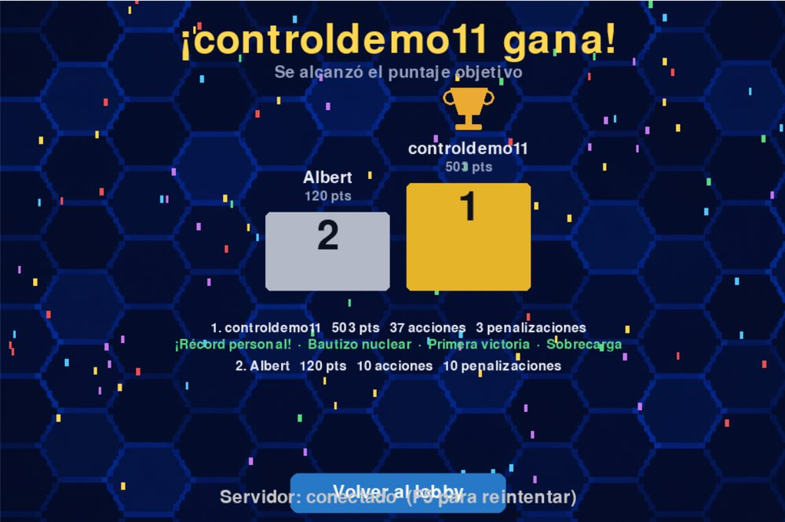

*La ceremonia: ganador, podio con trofeo, confeti, puntaje de cada jugador, acciones, penalizaciones y los logros y récords de la partida.*

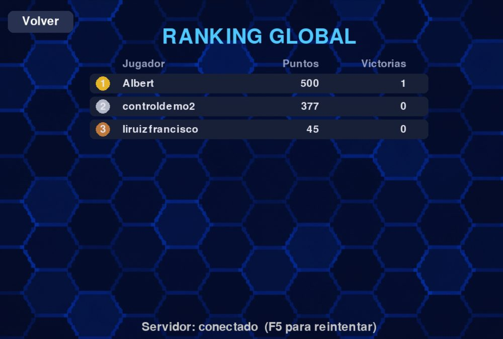

*El ranking global después de la partida, con medallas para los tres primeros.*

## 8. Logros

Se ganan una sola vez y quedan en tu historial:

| Logro | Cómo |
| --- | --- |
| Bautizo nuclear | Estar en una partida cuando termina |
| Primera victoria | Ganar una partida (quedar solo en el primer lugar; con empate arriba nadie lo gana) |
| Sobrecarga | Sacar 300 de energía del reactor en una misma partida (no cuentan las celdas ni los retos) |
| Intocable | Terminar la partida con puntos sin que te alcance ningún guardián |

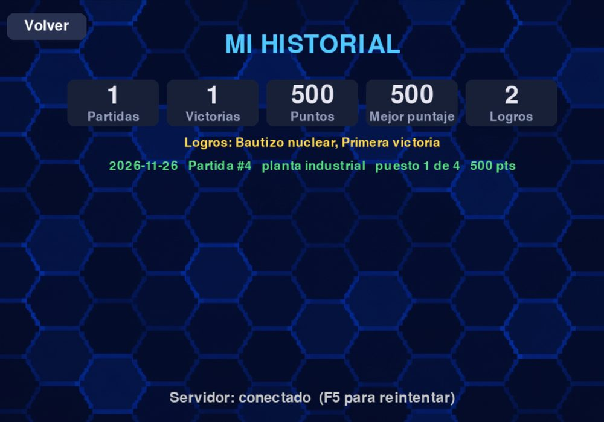

*Mi historial: partidas, victorias, puntos, mejor puntaje, logros y cada partida con su puesto.*

## 9. Administración (solo para la cuenta de administrador)

La cuenta de administrador la crea el equipo desde el servidor; no se puede pedir al registrarse. En su lobby aparece **Administración**, con:

- **Estadísticas:** usuarios registrados y bloqueados, partidas jugadas y activas, mejores puntajes.
- **Usuarios:** lista de cuentas con **Bloquear** y **Desbloquear**. Una cuenta bloqueada pierde la sesión y al intentar entrar ve *"Tu cuenta fue bloqueada por un administrador"*.
- **Partidas activas:** cerrar una partida que quedó abierta. Si estaba en curso, termina y se guardan los resultados como en cualquier final.

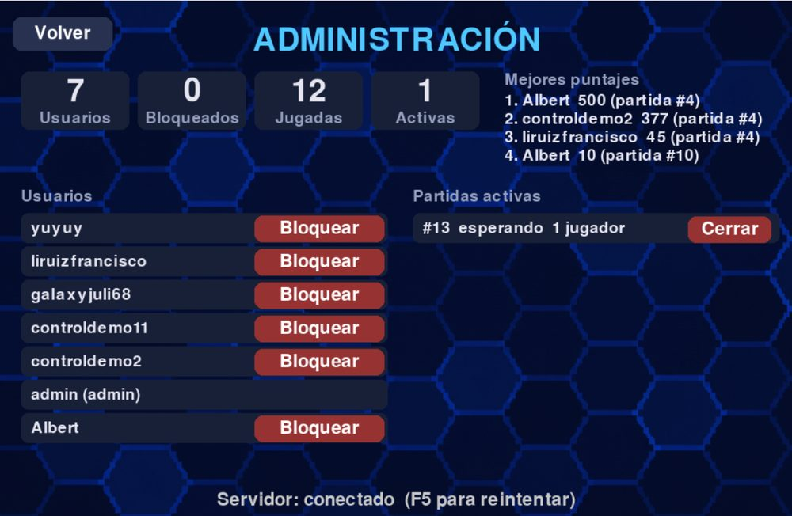

*Administración: estadísticas arriba, mejores puntajes a la derecha, usuarios con Bloquear o Desbloquear y partidas activas con Cerrar.*

## 10. Problemas comunes

| Qué pasa | Qué hacer |
| --- | --- |
| No llega el correo de verificación | Revisar spam o tocar **Reenviar correo**; si no, entrar con Google |
| "El correo ya está registrado" | Ese correo ya tiene cuenta: iniciá sesión o recuperá la contraseña |
| No puedo crear partida: "ya está en una partida activa" | Esperá un minuto: una partida sin iniciar y sin nadie conectado se cierra sola |
| El botón sigue gris con todos unidos | Alguien se salió del lobby y su conexión se cerró: que vuelva a unirse desde **Buscar partidas** |
| En el celular no sale el teclado o se ve una versión vieja | Recargar la página |
| En la compu sale "Canal: sin conexión" o la arena queda en blanco | Actualizar el juego en la compu (ver "Problemas comunes" del [Manual técnico](manual-tecnico.md)). Mientras tanto se puede jugar desde el navegador o el celular |
| El control físico no mueve al personaje | Ver la sección de control físico del [Manual técnico](manual-tecnico.md); mientras tanto se puede jugar con el teclado |
